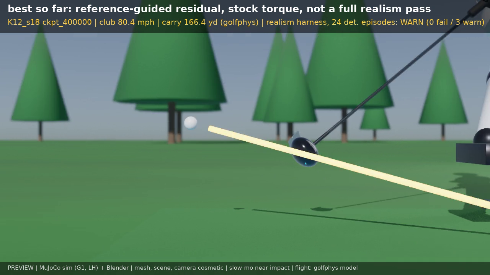

# humanoid-golf-sim: MuJoCo humanoid golf swing simulator and training (research preview)

[](LICENSE) [](https://github.com/masonwyatt23/humanoid-golf-sim)

Repository: <https://github.com/masonwyatt23/humanoid-golf-sim> (renamed 2026-10-18 from `humanoid-golf-scott`; GitHub redirects the old URL).

Autonomous pipeline for training a simulated humanoid to swing a golf club, using pure/textbook pro-swing references (including synthetic "style profile" references named `scott`, `scheffler`, `rory`; they are statistical style profiles, not models of any real person; see data provenance below) as style targets. This project is not affiliated with or endorsed by any named golfer.

## Preview (still image)


*K25b s56 400k, model-only physics, not a full realism pass.* About 50 ms before impact, seed 4000, no overlay text (image hosted as a release asset, not in git; caption details in `results/previews/K25b_s56_400k_readme_still_caption.txt`). Harness v3c: FAIL 14 / 3 / 1 (robustness). Seed-4000 episode: club 72.2 mph, below the 88-109 mph target.

Older still (kept for history):



*K12 s18 400k, model-only physics, fails realism checks.* One frame near impact from a Blender render of a K12 `s18` 400k rollout (mesh, scene and camera are cosmetic; ball flight is the golfphys model). **The overlay text in this frame is out of date.** It was burned in before the dt fix, the new gating checks and harness v3b. That checkpoint now scores **FAIL 11 pass / 4 warn / 3 fail** under v3b (`mine/start_direction`, `mine/lead_foot_plant`, `mine/robustness`), and it is no longer the "best so far" row. No GIFs or videos are committed.

## Status at a glance (default harness v3c, PROVISIONAL)

Every v5 row is a single training seed, uses model-only physics (golfphys impact/flight; carry has no roll), and is reference-guided residual RL with tracking assistance on stock G1 torque, **not from scratch**. **No row passes every check. Every v3c-scored row FAILs the PROVISIONAL `mine/robustness` gate.** There is no 350 yd result. Counts are pass / warn / fail, read from the committed JSONs.

Harness v3c (Evaluator `47f30f8`, the default since 2026-10-19). The Evaluator has now committed independent v3c scores for 12 rows (Evaluator `f817e7d`; notes in `results/v5_runs/stageJK_harness_summary/HARNESS_V3_RESCORE.md`). The Trainer's own v3c files for K27a and K27c are listed separately; where both exist (K27a 400k, K27c 300k) the counts match exactly. Robustness sub-checks are contact >= 0.95, start direction >= 0.90 and lead-foot plant >= 0.90 of the 24 perturbed episodes; several rows clear all three and still FAIL robustness on the perturbed-shot spin and total/carry spread.

| Row | Club mph (median) | v3c pass / warn / fail | Failing checks | Scored by | Source |
|---|---|---|---|---|---|
| Target (this project) | 88-109 | - | - | - | project goal, not a result |
| K12 `s18` 400k | 80.4 | 11 / 4 / 3 FAIL | start_direction, lead_foot_plant, robustness | Evaluator | `results/v5_runs/stageJK_harness_summary/realism_v5_K12_s18_400k_dtfix_newchecks_v3c_gateoff_gp_arm06.json` |
| K18e `s37` 200k | 74.1 | 12 / 5 / 1 FAIL | robustness | Evaluator | `results/v5_runs/stageJK_harness_summary/realism_v5_K18e_s37_200k_dtfix_newchecks_v3c_gateoff_gp_arm06.json` |
| K19a `s39` 300k | 72.8 | 13 / 4 / 1 FAIL | robustness | Evaluator | `results/v5_runs/stageJK_harness_summary/realism_v5_K19a_s39_300k_dtfix_newchecks_v3c_gateoff_gp_arm06.json` |
| K19a `s39` 400k | 73.4 | 13 / 4 / 1 FAIL | robustness | Evaluator | `results/v5_runs/stageJK_harness_summary/realism_v5_K19a_s39_400k_dtfix_newchecks_v3c_gateoff_gp_arm06.json` |
| K22r4 `s49` 500k | 71.5 | 12 / 5 / 1 FAIL | robustness | Evaluator | `results/v5_runs/stageJK_harness_summary/realism_v5_K22r4_s49_500k_dtfix_newchecks_v3c_gateoff_gp_arm06.json` |
| K22r5 `s51` 100k | 70.6 | 14 / 3 / 1 FAIL | robustness | Evaluator | `results/v5_runs/stageJK_harness_summary/realism_v5_K22r5_s51_100k_dtfix_newchecks_v3c_gateoff_gp_arm06.json` |
| K23b `s52` 300k | 70.6 | 14 / 3 / 1 FAIL | robustness | Evaluator | `results/v5_runs/stageJK_harness_summary/realism_v5_K23b_s52_300k_dtfix_newchecks_v3c_gateoff_gp_arm06.json` |
| K24a `s53` 200k | 70.6 | 13 / 4 / 1 FAIL | robustness | Evaluator | `results/v5_runs/stageJK_harness_summary/realism_v5_K24a_s53_200k_dtfix_newchecks_v3c_gateoff_gp_arm06.json` |
| K25b `s56` 400k | 72.2 | 14 / 3 / 1 FAIL | robustness | Evaluator | `results/v5_runs/stageJK_harness_summary/realism_v5_K25b_s56_400k_dtfix_newchecks_v3c_gateoff_gp_arm06.json` |
| K27a `s59` 400k | 70.3 | 12 / 3 / 3 FAIL | spin_rpm, total_over_carry, robustness | Evaluator | `results/v5_runs/stageJK_harness_summary/realism_v5_K27a_s59_400k_dtfix_newchecks_v3c_gateoff_gp_arm06.json` |
| K27b `s60` 400k | 74.0 | 13 / 3 / 2 FAIL | spin_rpm, robustness | Evaluator | `results/v5_runs/stageJK_harness_summary/realism_v5_K27b_s60_400k_dtfix_newchecks_v3c_gateoff_gp_arm06.json` |
| K27c `s61` 300k | 73.9 | 12 / 4 / 2 FAIL | spin_rpm, robustness | Evaluator | `results/v5_runs/stageJK_harness_summary/realism_v5_K27c_s61_300k_dtfix_newchecks_v3c_gateoff_gp_arm06.json` |
| K27a `s59` 200k | 70.4 | 12 / 5 / 1 FAIL | robustness | Trainer | `results/v5_runs/stageJ_harness/K27a_s59_200000_v3.json` |
| K27a `s59` 300k | 70.2 | 12 / 4 / 2 FAIL | total_over_carry, robustness | Trainer | `results/v5_runs/stageJ_harness/K27a_s59_300000_v3.json` |
| K27a `s59` 400k | 70.3 | 12 / 3 / 3 FAIL | spin_rpm, total_over_carry, robustness | Trainer | `results/v5_runs/stageJ_harness/K27a_s59_400000_v3.json` |
| K27c `s61` 100k | 74.1 | 13 / 3 / 2 FAIL | spin_rpm, robustness | Trainer | `results/v5_runs/stageJ_harness/K27c_s61_100000_v3.json` |
| K27c `s61` 200k | 74.1 | 12 / 4 / 2 FAIL | spin_rpm, robustness | Trainer | `results/v5_runs/stageJ_harness/K27c_s61_200000_v3.json` |
| K27c `s61` 300k | 73.9 | 12 / 4 / 2 FAIL | spin_rpm, robustness | Trainer | `results/v5_runs/stageJ_harness/K27c_s61_300000_v3.json` |
| K28a `s62` 100k | 73.7 | 12 / 5 / 1 FAIL | robustness | Evaluator (Trainer agrees) | `results/v5_runs/stageJK_harness_summary/realism_v5_K28a_s62_100k_dtfix_newchecks_v3c_gateoff_gp_arm06.json` |
| K28a `s62` 200k | 73.5 | 11 / 5 / 2 FAIL | spin_rpm, robustness | Evaluator (Trainer agrees) | `results/v5_runs/stageJK_harness_summary/realism_v5_K28a_s62_200k_dtfix_newchecks_v3c_gateoff_gp_arm06.json` |
| K28a `s62` 300k | 72.9 | 11 / 5 / 2 FAIL | spin_rpm, robustness | Evaluator (Trainer agrees) | `results/v5_runs/stageJK_harness_summary/realism_v5_K28a_s62_300k_dtfix_newchecks_v3c_gateoff_gp_arm06.json` |
| K28a `s62` 400k | 73.8 | 12 / 4 / 2 FAIL | spin_rpm, robustness | Evaluator (Trainer agrees) | `results/v5_runs/stageJK_harness_summary/realism_v5_K28a_s62_400k_dtfix_newchecks_v3c_gateoff_gp_arm06.json` |
| K28b `s63` 100k | 73.9 | 12 / 4 / 2 FAIL | spin_rpm, robustness | Evaluator (Trainer agrees) | `results/v5_runs/stageJK_harness_summary/realism_v5_K28b_s63_100k_dtfix_newchecks_v3c_gateoff_gp_arm06.json` |
| K28b `s63` 200k | 74.1 | 13 / 3 / 2 FAIL | spin_rpm, robustness | Evaluator (Trainer agrees) | `results/v5_runs/stageJK_harness_summary/realism_v5_K28b_s63_200k_dtfix_newchecks_v3c_gateoff_gp_arm06.json` |
| K28b `s63` 300k | 73.9 | 12 / 5 / 1 FAIL | robustness | Evaluator (Trainer agrees) | `results/v5_runs/stageJK_harness_summary/realism_v5_K28b_s63_300k_dtfix_newchecks_v3c_gateoff_gp_arm06.json` |
| K28b `s63` 400k | 73.8 | 12 / 5 / 1 FAIL | robustness | Evaluator (Trainer agrees) | `results/v5_runs/stageJK_harness_summary/realism_v5_K28b_s63_400k_dtfix_newchecks_v3c_gateoff_gp_arm06.json` |
| K29a `s64` 100k | 73.6 | 12 / 4 / 2 FAIL | spin_rpm, robustness | Evaluator (Trainer agrees) | `results/v5_runs/stageJK_harness_summary/realism_v5_K29a_s64_100k_dtfix_newchecks_v3c_gateoff_gp_arm06.json` |
| K29a `s64` 200k | 73.7 | 12 / 3 / 3 FAIL | spin_rpm, total_over_carry, robustness | Evaluator (Trainer agrees) | `results/v5_runs/stageJK_harness_summary/realism_v5_K29a_s64_200k_dtfix_newchecks_v3c_gateoff_gp_arm06.json` |
| K29a `s64` 300k | 73.8 | 12 / 3 / 3 FAIL | spin_rpm, total_over_carry, robustness | Evaluator (Trainer agrees) | `results/v5_runs/stageJK_harness_summary/realism_v5_K29a_s64_300k_dtfix_newchecks_v3c_gateoff_gp_arm06.json` |
| K29a `s64` 400k | 73.8 | 12 / 4 / 2 FAIL | spin_rpm, robustness | Evaluator (Trainer agrees) | `results/v5_runs/stageJK_harness_summary/realism_v5_K29a_s64_400k_dtfix_newchecks_v3c_gateoff_gp_arm06.json` |
| K29b `s65` 100k | 74.0 | 12 / 4 / 2 FAIL | spin_rpm, robustness | Evaluator (Trainer agrees) | `results/v5_runs/stageJK_harness_summary/realism_v5_K29b_s65_100k_dtfix_newchecks_v3c_gateoff_gp_arm06.json` |
| K29b `s65` 200k | 74.0 | 12 / 4 / 2 FAIL | spin_rpm, robustness | Evaluator (Trainer agrees) | `results/v5_runs/stageJK_harness_summary/realism_v5_K29b_s65_200k_dtfix_newchecks_v3c_gateoff_gp_arm06.json` |
| K29b `s65` 300k | 74.2 | 12 / 3 / 3 FAIL | spin_rpm, total_over_carry, robustness | Evaluator (Trainer agrees) | `results/v5_runs/stageJK_harness_summary/realism_v5_K29b_s65_300k_dtfix_newchecks_v3c_gateoff_gp_arm06.json` |
| K29b `s65` 400k | 73.6 | 12 / 3 / 3 FAIL | spin_rpm, total_over_carry, robustness | Evaluator (Trainer agrees) | `results/v5_runs/stageJK_harness_summary/realism_v5_K29b_s65_400k_dtfix_newchecks_v3c_gateoff_gp_arm06.json` |
| K30a `s66` 100k | 73.8 | 13 / 4 / 1 FAIL | robustness | Evaluator (Trainer agrees) | `results/v5_runs/stageJK_harness_summary/realism_v5_K30a_s66_100k_dtfix_newchecks_v3c_gateoff_gp_arm06.json` |
| K30a `s66` 200k | 73.8 | 12 / 4 / 2 FAIL | spin_rpm, robustness | Evaluator (Trainer agrees) | `results/v5_runs/stageJK_harness_summary/realism_v5_K30a_s66_200k_dtfix_newchecks_v3c_gateoff_gp_arm06.json` |
| K30a `s66` 300k | 73.7 | 12 / 4 / 2 FAIL | spin_rpm, robustness | Evaluator (Trainer agrees) | `results/v5_runs/stageJK_harness_summary/realism_v5_K30a_s66_300k_dtfix_newchecks_v3c_gateoff_gp_arm06.json` |
| K30b `s67` 100k | 73.6 | 12 / 3 / 3 FAIL | spin_rpm, total_over_carry, robustness | Evaluator (Trainer agrees) | `results/v5_runs/stageJK_harness_summary/realism_v5_K30b_s67_100k_dtfix_newchecks_v3c_gateoff_gp_arm06.json` |
| K30b `s67` 200k | 73.6 | 12 / 3 / 3 FAIL | spin_rpm, total_over_carry, robustness | Evaluator (Trainer agrees) | `results/v5_runs/stageJK_harness_summary/realism_v5_K30b_s67_200k_dtfix_newchecks_v3c_gateoff_gp_arm06.json` |
| K30b `s67` 300k | 73.5 | 12 / 3 / 3 FAIL | spin_rpm, total_over_carry, robustness | Evaluator (Trainer agrees) | `results/v5_runs/stageJK_harness_summary/realism_v5_K30b_s67_300k_dtfix_newchecks_v3c_gateoff_gp_arm06.json` |
| K30b `s67` 400k | 73.7 | 12 / 3 / 3 FAIL | spin_rpm, total_over_carry, robustness | Evaluator (Trainer agrees) | `results/v5_runs/stageJK_harness_summary/realism_v5_K30b_s67_400k_dtfix_newchecks_v3c_gateoff_gp_arm06.json` |
| K31a `s68` 100k | 73.7 | 12 / 5 / 1 FAIL | robustness | Trainer only | `results/v5_runs/stageJ_harness/K31a_s68_100000_v3.json` |
| K31a `s68` 200k | 73.6 | 12 / 5 / 1 FAIL | robustness | Evaluator (Trainer agrees) | `results/v5_runs/stageJK_harness_summary/realism_v5_K31a_s68_200k_dtfix_newchecks_v3c_gateoff_gp_arm06.json` |
| K31a `s68` 300k | 73.4 | 12 / 4 / 2 FAIL | spin_rpm, robustness | Trainer only | `results/v5_runs/stageJ_harness/K31a_s68_300000_v3.json` |
| K31b `s69` 100k | 74.1 | 13 / 4 / 1 FAIL | robustness | Trainer only | `results/v5_runs/stageJ_harness/K31b_s69_100000_v3.json` |
| K31b `s69` 200k | 73.6 | 12 / 4 / 2 FAIL | spin_rpm, robustness | Trainer only | `results/v5_runs/stageJ_harness/K31b_s69_200000_v3.json` |
| K31b `s69` 300k | 73.8 | 12 / 4 / 2 FAIL | spin_rpm, robustness | Trainer only | `results/v5_runs/stageJ_harness/K31b_s69_300000_v3.json` |
| K31c `s70` 100k | 73.7 | 12 / 5 / 1 FAIL | robustness | Trainer only | `results/v5_runs/stageJ_harness/K31c_s70_100000_v3.json` |
| K31c `s70` 200k | 73.6 | 12 / 5 / 1 FAIL | robustness | Trainer only | `results/v5_runs/stageJ_harness/K31c_s70_200000_v3.json` |
| K31c `s70` 300k | 73.7 | 12 / 3 / 3 FAIL | spin_rpm, total_over_carry, robustness | Trainer only | `results/v5_runs/stageJ_harness/K31c_s70_300000_v3.json` |
| K31d `s71` 100k | 74.1 | 13 / 4 / 1 FAIL | robustness | Trainer only | `results/v5_runs/stageJ_harness/K31d_s71_100000_v3.json` |
| K31d `s71` 200k | 74.0 | 12 / 4 / 2 FAIL | spin_rpm, robustness | Trainer only | `results/v5_runs/stageJ_harness/K31d_s71_200000_v3.json` |
| K31d `s71` 300k | 73.7 | 11 / 5 / 2 FAIL | spin_rpm, robustness | Trainer only | `results/v5_runs/stageJ_harness/K31d_s71_300000_v3.json` |
| K32a `s72` 100k | 73.5 | 12 / 3 / 3 FAIL | spin_rpm, total_over_carry, robustness | Trainer only | `results/v5_runs/stageJ_harness/K32a_s72_100000_v3.json` |
| K32a `s72` 200k | 73.2 | 12 / 4 / 2 FAIL | total_over_carry, robustness | Trainer only | `results/v5_runs/stageJ_harness/K32a_s72_200000_v3.json` |
| K32a `s72` 300k | 73.2 | 12 / 3 / 3 FAIL | spin_rpm, total_over_carry, robustness | Trainer only | `results/v5_runs/stageJ_harness/K32a_s72_300000_v3.json` |
| K32b `s73` 100k | 73.5 | 11 / 4 / 3 FAIL | spin_rpm, total_over_carry, robustness | Trainer only | `results/v5_runs/stageJ_harness/K32b_s73_100000_v3.json` |
| K32b `s73` 200k | 73.2 | 11 / 4 / 3 FAIL | spin_rpm, total_over_carry, robustness | Trainer only | `results/v5_runs/stageJ_harness/K32b_s73_200000_v3.json` |
| K32b `s73` 300k | 73.0 | 11 / 4 / 3 FAIL | spin_rpm, total_over_carry, robustness | Trainer only | `results/v5_runs/stageJ_harness/K32b_s73_300000_v3.json` |

Best by the agreed order (fewest FAILs, then WARNs): K22r5 100k, K23b 300k and K25b 400k at 14/3/1, each FAILing robustness only. **K27b 400k re-checked:** the Evaluator's v3c file shows 13/3/2 (spin_rpm, robustness; foot-plant robustness 0.75), which confirms the Trainer-reported 13/3/2 that had no committed file before. **K27c 300k:** passes all three robustness sub-checks (contact 1.00, start direction 0.92, foot 0.96) but FAILs nominal spin (3978 rpm) and robustness (spin p90 4683, total/carry p90 1.76). It is not the first row to clear the three sub-checks: K24a 200k (1.00/1.00/1.00), K22r4 500k, K27a 300k and K27a 400k already do in the committed files. **K28-K30:** the Evaluator (`228eca4`) independently scored K28a/b 100k-400k and K29a/b 100k-300k and matches the Trainer exactly (v3c 14/14, v3d 8/8). It confirms K28b `s63` 400k at v3c 12 / 5 / 1 FAIL (robustness: perturbed spin p90 and total/carry spread), tied with K28b 300k and K28a 100k; that is the best K28/K29 row, but **not the best overall**: K22r5, K23b and K25b are at 14 / 3 / 1. K29a/b 400k and all K30a/K30b rows are **Trainer only**; the best of them, K30a `s66` 100k at 13 / 4 / 1 (robustness only), is not Evaluator-confirmed. K29 (sep_lo 20 ms, spin_hi 2800) made deterministic spin worse (FAIL on every K29 row). The K30 reference fit (`results/v5_runs/stageK30_ref_s1/`) missed its targets and is **not used** for training. **K31a-d** (strike-location / face-edge shaping terms, default off; `--face_h` real 53 mm face only in K31c/d): only K31a 200k is Evaluator-scored (Evaluator `6a74779`: v3c 12 / 5 / 1, matches the Trainer; first row with all three robustness rates 1.00, still FAILs on club p10 and t/c spread); the rest are **Trainer only**: best v3c 13 / 4 / 1 (K31b `s69` 100k, K31d `s71` 100k), FAIL robustness; none beats the 14 / 3 / 1 rows and none passes every check. Under v3d (Trainer re-grade) K31a/b/c/d 100k reach 14 / 3 / 1, still FAIL robustness. **K32a/b** (Trainer only; `--tee_dz`/`--ball_dx` flags default 0; K32 keys hand-edited from K27, no refit): all FAIL (best v3c 12 / 4 / 2, K32a 200k). **K32a re-scored by the Evaluator** (`6210641`; K32a trains with the tee raised 20 mm): v3c at the old tee 100k 12 / 3 / 3, 200k 12 / 4 / 2 FAIL (`results/v5_runs/stageJK_harness_summary/realism_v5_K32a_s72_{100k,200k}_tee0box_v3c_gateoff_gp_arm06.json`); v3d with the harness-derived crown-level tee (21.46 mm) **100k 15 / 2 / 2, 200k 15 / 3 / 1 FAIL** (robustness: club p10 0.82x, start direction 0.88, spin p10, t/c p90; `results/v5_runs/stageJK_harness_summary/realism_v5_K32a_s72_{100k,200k}_teecrownbox_v3d_gateoff_gp_arm06.json`). The crown-tee rows are **info / compensation only** (they compensate for the oversized sim head); the pass rule uses the **default tee**, where K32a scores v3d 13 / 2 / 4 (100k) and 14 / 3 / 2 (200k) in the Evaluator's tee-0 counterfactual. Not a pass. 15 passes is the highest v3d pass count in the committed files, tied with K22r5 100k (v3d 15 / 2 / 1, scored before the strike and face-edge rows existed); v3c and v3d counts are not comparable, and the best v3c rows remain 14 / 3 / 1. Main scores use the **64 mm face box** (the physics every earlier row used); the `face_h` 0.053 (real 53 mm face) runs, `*_tee0_v3c_*`, `*_teecrown_v3d_*` and `*_teeargs_v3d_*`, are **sensitivity files only, pending a decision**. The Evaluator's K30a 100k regression with the new pass-through is identical on every deterministic row. **No full pass.**

## Harness v3d (PROVISIONAL, opt-in, under review)

`--harness v3d` (Evaluator `6b0db8c`; v3c stays the default) re-grades the v3c episodes with DERIVED bands from a Trainer band check: spin PASS 2000-3700 rpm at 70-85 mph, pelvis floor 250 dps (info target 340), thorax/arm tie or inversion <= 30 ms and arm-to-club >= 20 ms, plus a LOW CONFIDENCE robustness rule (club p10 >= 0.93 x median) and a "not a pass (spin-band-only)" flag. Rules and sources: [`docs/HARNESS_V3D_NOTES.md`](docs/HARNESS_V3D_NOTES.md). These bands are derived, not published thresholds.

Comparison (Evaluator `2a8f897`, all 12 rows, `HARNESS_V3_RESCORE.md`): **no row passes under v3c or v3d**, and every row still FAILs robustness. v3d mostly turns WARNs into PASSes (kinematic order, spin, pelvis), so counts look better (K27b 400k 15/1/2, K22r5 100k 15/2/1) without any new pass. 11 of 12 rows fail the new club p10 rule (only K27a 400k, 0.99, clears it), and the arm-to-club >= 20 ms rule keeps the timing row at WARN for every row (max 16 ms, K25b). A live `--harness v3d` run of K25b 400k reproduced the re-grade exactly.

**v3d strike and face-edge rules (PROVISIONAL, v3d only; Evaluator `4bb0801`..`eaf3f9e`; v3c verdicts unchanged):** strike dy/dz INFO rows in all v3 harnesses; `mine/strike_height` (median |dz|: WARN > 15 mm, a design choice; FAIL >= `STRIKE_FACE_EDGE_MM` = 26.5 mm, measured spec of a single brand, Wishon 919THI 53 mm face, provisional). Side-by-side face-edge model on a golfphys centre strike via `face_edge_adjust` in `data/driver_face_offcentre.py` (the single implementation, INFO rows, never the default): smash from the R22-07-derived table is primary (MEDIUM within 21 mm, LOW beyond); spin passes only if capped AND linear AND R22-07 spin all pass; launch passes only if both the Hotstix 0.20 deg/mm and R22-07 Fig 3 launch are in 7-16 deg; no data = not a pass. R22-07 constants are derived from digitized figures, approximate. Notes: `docs/HARNESS_V3D_NOTES.md`. K28/K29 (Evaluator `228eca4`, live `--harness v3d`): no row passes; all FAIL robustness; 12 of 14 fail the club p10 rule. Best v3d count is K28a `s62` 100k at 14 / 3 / 1, the first row whose v3d sequencing timing passes (arm 20 ms before club), still FAILing robustness. **Evaluator `6a74779` now confirms K29a/b 400k, K30a 100k-300k, K30b 100k-400k and K31a 200k under v3c (10/10 match the Trainer)**, and re-scores them under live v3d with the new strike and face-edge rows (below): best row K30a `s66` 100k, v3c 13 / 4 / 1, v3d 14 / 4 / 1, FAIL robustness only; K29b 400k and K30b 100k/200k/400k strike more than 26.5 mm below face centre (off a real 53 mm face) and FAIL `mine/strike_height`. **No full pass under v3c, v3d or the face-edge side-by-side model.** The Trainer's older v3d files (without the strike row) are in `results/v5_runs/stageJ_harness/*_v3d.json` (best K30a 100k 14 / 3 / 1, not Evaluator-confirmed).

## Previous default: harness v3b (PROVISIONAL)


Scored under v3b (gate friction U(0.9,1.1)), kept for history; the Evaluator rows are now re-scored under v3c above. Same labels: single seed, model-only physics, not from scratch, **no row passes every check, every row FAILs `mine/robustness`**.

| Row | Club mph (median) | v3b pass / warn / fail | Failing checks | Scored by | Source |
|---|---|---|---|---|---|
| Target (this project) | 88-109 | - | - | - | project goal, not a result |
| K22r5 `s51` 100k (most passes; first row with correct kinematic order) | 70.6 | 14 / 3 / 1 FAIL | robustness | Evaluator + Trainer agree | `results/v5_runs/stageJK_harness_summary/realism_v5_K22r5_s51_100k_dtfix_newchecks_v3b_gateoff_gp_arm06.json`, `results/v5_runs/stageJ_harness/K22r5_s51_100000_v3.json` |
| K23b `s52` 300k | 70.6 | 14 / 3 / 1 FAIL | robustness | Trainer only | `results/v5_runs/stageJ_harness/K23b_s52_300000_v3.json` |
| K25b `s56` 400k | 72.2 | 14 / 3 / 1 FAIL | robustness | Trainer only | `results/v5_runs/stageJ_harness/K25b_s56_400000_v3.json` |
| K24a `s53` 200k (robustness-randomized training; ball noise re-applied per reset, worker fix `cec13eb`) | 70.6 | 13 / 4 / 1 FAIL | robustness (spin and t/c spread) | Evaluator + Trainer agree | `results/v5_runs/stageJK_harness_summary/realism_v5_K24a_s53_200k_v3b_gateoff_gp_arm06.json`, `results/v5_runs/stageJ_harness/K24a_s53_200000_v3.json` |
| K19a `s39` 300k / 400k | 72.8 / 73.4 | 13 / 4 / 1 FAIL each | robustness | Evaluator | `results/v5_runs/stageJK_harness_summary/realism_v5_K19a_s39_{300k,400k}_dtfix_newchecks_v3b_gateoff_gp_arm06.json` |
| K22r4 `s49` 500k (zero-fail under v2, not under v3b) | 71.5 | 12 / 5 / 1 FAIL | robustness | Evaluator + Trainer agree | `results/v5_runs/stageJK_harness_summary/realism_v5_K22r4_s49_500k_dtfix_newchecks_v3b_gateoff_gp_arm06.json` |
| K18e `s37` 200k | 74.1 | 12 / 5 / 1 FAIL | robustness | Evaluator | `results/v5_runs/stageJK_harness_summary/realism_v5_K18e_s37_200k_dtfix_newchecks_v3b_gateoff_gp_arm06.json` |
| K26s `s58` 100k (fastest K24-K26 row) | 75.0 | 12 / 5 / 1 FAIL | robustness | Trainer only | `results/v5_runs/stageJ_harness/K26s_s58_100000_v3.json` |
| K12 `s18` 400k (fastest scored row; preview above) | 80.4 | 11 / 4 / 3 FAIL | start_direction, lead_foot_plant, robustness | Evaluator | `results/v5_runs/stageJK_harness_summary/realism_v5_K12_s18_400k_dtfix_newchecks_v3b_gateoff_gp_arm06.json` |

All K24-K26 harness files (`results/v5_runs/stageJ_harness/K2[4-6]*_v3.json`, scored under v3b, including K26r `s57` / K26s `s58` 300k at 12/5/1 and 11/6/1) FAIL robustness; several also fail `shot/total_over_carry` or `shot/spin_rpm`. The `swing/grf_lead_vertical_bw` **1.7 BW upper limit has no published source**, and **the v3b robustness gate's friction range (U(0.9,1.1)) has no turf source**. Both are PROVISIONAL. The v3c range is sourced but only with medium-low confidence (see the harness section). The detailed v2-era table further down is kept for history.

## Research bands

- **Trainer-only V10o-V11o rows** (`--env_v4`, V10h/V10r keys, Trainer-local runs of the Evaluator v4 worker, NOT official, single seed, model-only; all FAIL; rows with 0/24 contact are nominal misses, so ignore them when ranking). Best per run is 13/5/1 FAIL at the 1.5 in tee, failing robustness only. That holds for V10s, V10u, V10w, V10x, V10y, V11c-g, V11i-k, V11m and V11o; for example `V10u_s112_100000_v3_tee15in_v4h_v4.json` and `V11k_s127_150000_v3_tee15in_v4h_v4.json` (contact 0.83). Robustness contact stays at or below 0.83 against the 0.95 gate. Zero-residual reference probes R0V10h/R0V10r (pure reference keys) score 2 fails. **Plant diagnosis (Trainer's diagnosis, single seed, local):** the harness plant fraction counts misses and foot warns as non-passes, so plant failures are mostly contact under noise. V10l 100k: 16/24 = 0.67, and 16/20 contacts pass foot (TRAINING_NOTES). `--miss0_w` (extra miss penalty on noisy address starts) is off by default.
- **V16 official grade (Evaluator-scored, harness v4 PROVISIONAL, 1.5 in tee gating, single seed, model-only; Trainer export 4d22d58a; V12X refit keys)**: V18f_s530 50k **12/6/1 FAIL**, failing mine/robustness only (contact 0.917, start direction 0.875, lead-foot plant 0.833 vs gates 0.95/0.90/0.90). Nominal total/carry 1.303 WARN. Within harness v4: start direction is up from V18d (0.792) but plant is down (0.875 -> 0.833), so no row passes every check. v5 D-plane (NON-GATING, corrected on perturbed robustness episodes): start vs 0.85 x face 16/22 = 0.727 WARN, curvature sign 21/21 (`results/overnight/DPLANE_CORRECTION.md`; the original "24/24" was nominal-only, n=1). Crown 1.6 in info only; v5 held-out rows NON-GATING. V12X keys: `results/v5_runs/stageV12X_ref_s1/tuned_keys_flat.json` (refit-proxy held-out results in `results/v10_diag/V12X_holdout_pid5000.json`; its D-plane proxy fields are INVALID, see `results/v10_diag/dplane_calibration.md`). The V18f training args are not yet in the repo. Local Trainer-only finding: V18f's perturbed start-direction misses are heel-strike gear-effect pulls (r .98 between start error and strike dy in `results/v17_face/faceh_V18f_s530_50000.csv`), not face control. Source: `results/overnight/V16_GRADE.md`, rows `results/overnight/realism_v5_V18f_s530_50k_*.json` (slim).
- **V15 official grade (Evaluator-scored, harness v4 PROVISIONAL, 1.5 in tee gating, single seed, model-only; Trainer export 2a511cb9; V12V refit keys `results/v5_runs/stageV12V_ref_s1/tuned_keys_flat.json`)**: V18d_s511 50k **13/5/1 FAIL**, failing mine/robustness only (contact 0.917, start direction 0.792, lead-foot plant 0.875 vs gates 0.95/0.90/0.90). Nominal shot/total_over_carry 1.285 is a WARN (DERIVED band). Within harness v4: V14 rows passed the robustness triple but failed total/carry; V18d fixes nominal total/carry to WARN but fails the triple again, so no row passes every check. Crown 1.6 in info only; v5 held-out and D-plane rows are NON-GATING estimates. V18d training config: `results/v5_runs/configs/V18d_s511_args.json` (Trainer args; the init checkpoint it names is not in git). Source: `results/overnight/V15_GRADE.md`, rows `results/overnight/realism_v5_V18d_s511_50k_*.json` (slim). D-plane note: earlier v5 D-plane figures in the V13-V16 grade docs ("24/24", "0/24") were NOMINAL-ONLY (n=1, identical deterministic rollouts); corrected on the perturbed v4 robustness episodes (NON-GATING, `results/overnight/DPLANE_CORRECTION.md`): V18d start vs 0.85 x face 9/22 = 0.409 FAIL.
- **V14 official grades (Evaluator-scored, harness v4 PROVISIONAL, 1.5 in tee gating, single seed, model-only; Trainer export eafa270c; V12U refit keys `results/v5_runs/stageV12U_ref_s1/tuned_keys_flat.json`)**: V16y_s402 50k **13/4/2 FAIL** and V17f_s422 50k **13/4/2 FAIL**. Both fail shot/total_over_carry (nominal 1.403 and 1.438) and mine/robustness. These are the first official rows where the robustness triple passes its gates (contact 0.958, start direction 0.917, lead-foot plant 0.917 on both), but mine/robustness still fails on its total/carry and spin sub-requirements and nominal total/carry fails, so no row passes every check. Crown 1.6 in rows info only; v5 held-out and D-plane rows are NON-GATING estimates. Training configs: `results/v5_runs/configs/V16y_s402_args.json` and `V17f_s422_args.json` (Trainer args; the init checkpoints they name are not in git). The start-direction gain comes from toe strike / gear effect (launch azimuth tracks strike dy, not face; `results/v17_face`, `results/v10_diag/dy_frame_check_V17.md`, local rollouts), not face control; start direction is not solved. Source: `results/overnight/V14_GRADE.md`, rows `results/overnight/realism_v5_V16y_s402_50k_*.json` and `realism_v5_V17f_s422_50k_*.json` (slim). D-plane note: earlier v5 D-plane figures in the V13-V16 grade docs ("24/24", "0/24") were NOMINAL-ONLY (n=1, identical deterministic rollouts); corrected on the perturbed v4 robustness episodes (NON-GATING, `results/overnight/DPLANE_CORRECTION.md`): V16y 10/23 = 0.435 FAIL; V17f not re-run.
- **V13 official grade (Evaluator-scored, harness v4 PROVISIONAL, 1.5 in tee gating, single seed, model-only; Trainer export 5b8dbd4; V12T refit keys + turn margin `--turn_m_w 3 --turn_tgt 6.5`)**: V13h_s240 50k **13/5/1 FAIL**, failing robustness only (contact 0.917, start direction 0.75, lead-foot plant 0.875). Crown 1.6 in row info only; v5 held-out rows are NON-GATING estimates. No row passes every check. Source: `results/overnight/V13_GRADE.md`, rows `results/overnight/realism_v5_V13h_s240_50k_*.json` (slim).
- **V12 official grades (Evaluator-scored, harness v4 PROVISIONAL, 1.5 in tee gating, single seed, model-only; Trainer export 474e6c5; reference re-tuned open-loop by CMA-ES with stock G1 torque, warm-started, on the V10h refit keys)**: V10l_s104 100k **13/5/1 FAIL** and V10l_s104 150k **13/5/1 FAIL**, each failing robustness only (contact 0.83; plant 0.67 and 0.62). 24/24 true contacts each. Crown 1.6 in rows info only. No row passes every check. Source: `results/overnight/V12_GRADE.md`, rows `results/overnight/realism_v5_V10l_s104_*.json` (slim).
- **V11 official grades (Evaluator-scored, harness v4 PROVISIONAL, 1.5 in tee gating, single seed, model-only; Trainer export 55fa733; reference re-tuned open-loop by CMA-ES with stock G1 torque, warm-started, on the V10c refit keys with the lead-foot slip/turn term)**: V10e_s98 100k **13/5/1 FAIL** and V10e_s98 50k **13/5/1 FAIL**, each failing robustness only. 24/24 true contacts each. Crown 1.6 in rows info only. No row passes every check. Source: `results/overnight/V11_GRADE.md`, rows `results/overnight/realism_v5_V10e_s98_*.json` (slim).
- **Trainer-only V10 rows** (`--env_v4`, V10/V10b/V10c refit keys with a lead-foot slip/turn term (`scripts/v10_ref_fit.py`), Trainer-local runs of the Evaluator v4 worker, NOT official, single seed, model-only; all FAIL): best harness v4 grade 13/5/1 FAIL at the 1.5 in tee for V10e 100k (`results/v5_runs/stageJ_harness/V10e_s98_100000_v3_tee15in_v4h_v4.json`); the Evaluator confirms V10e 100k (and 50k) at 13/5/1 FAIL in `results/overnight/V11_GRADE.md`, also V10e 50k and V10f 150k. V10a/V10d best 13/4/2, V10b best 11/5/3, V10g/V10i best 12/6/1. Rows with 0/24 contact are nominal misses, so ignore them when ranking. Later V10 runs (V10h refit keys `results/v5_runs/stageV10h_ref_s1/`): V10l 100k 13/5/1 FAIL with plant 0.67 (`V10l_s104_100000_v3_tee15in_v4h_v4.json`), which the Evaluator confirms at 13/5/1 FAIL (`results/overnight/V12_GRADE.md`), and V10l 150k, V10n 50k and V10n 150k also 13/5/1 FAIL. **V10i finding (Trainer, single seed):** a stronger `--dz_lin_w` (45) made the strike lower (nominal harness dz -16.6 to -20.5 mm vs -12.8 for V10e 100k). The env dz equals the harness dz (-18.04 mm in both for V10i 100k, seeds 7000-7005: `results/v10_diag/dz_env_vs_golfphys_V10i100k.md`), but other rewards outweigh it. See TRAINING_NOTES.
- **V10 official grades (Evaluator-scored, harness v4 PROVISIONAL, 1.5 in tee gating, single seed, model-only; Trainer export f7cbc55)**: V9b_s92 300k **12/6/1 FAIL**, V9b_s92 150k **12/6/1 FAIL** and V9a_s91 50k **12/6/1 FAIL**, each failing robustness only; V8b_s89 400k **14/3/2 FAIL** (robustness, total/carry 1.782). 24/24 true contacts each. Crown 1.6 in rows info only. No row passes every check. V8b_s89 400k **flag-bug note:** per the Trainer's erratum in `ac13405`, V8b trained without its intended flags (base reward only); its score stands as measured but doesn't test those flags. Source: `results/overnight/V10_GRADE.md`, rows `results/overnight/realism_v5_{V9b_s92_300k,V9b_s92_150k,V9a_s91_50k,V8b_s89_400k}_*.json` (slim).
- **V9 official grades (Evaluator-scored, harness v4 PROVISIONAL, 1.5 in tee gating, single seed, model-only; Trainer export f7cbc55, which contains the `ac13405` flag fix)**: V9a_s91 150k **11/7/1 FAIL** (robustness); V9a_s91 100k **12/5/2 FAIL** (robustness, total/carry 1.363); V8a_s90 300k **12/6/1 FAIL** (robustness). 24/24 true contacts each. Crown 1.6 in rows info only. Nothing passes in full. V8a_s90 is a V8 run, so the flag-bug note below applies to it. Source: `results/overnight/V9_GRADE.md`.
- **Trainer-only V9 rows** (`--env_v4`, Trainer-local runs of the Evaluator v4 worker, NOT official, single seed, model-only; all FAIL): V9 is the first run with the V5-V8 flags and the new `--plant_h_w` actually active (fix in `ac13405`). Best harness v4 grade V9b 100k 13/4/2 FAIL at the 1.5 in tee (`results/v5_runs/stageJ_harness/V9b_s92_100000_v3_tee15in_v4h_v4.json`); V9a best 12/6/1 (50k), V9c best 11/7/1 (100k). Rank with `scripts/v9_rank.py V9a V9b V9c`. Diag: `results/v9_diag/`.
- **V8 official grades (Evaluator-scored, harness v4 PROVISIONAL, 1.5 in tee gating, single seed, model-only; Trainer export 79d86eb)**: V8a_s90 100k **12/6/1 FAIL** (robustness); V8b_s89 250k **11/6/2 FAIL** (robustness, total/carry). Crown 1.6 in rows info only. Neither is a full pass. Source: `results/overnight/V8_GRADE.md`. **Flag-bug note:** per the Trainer's erratum in `ac13405`, the V5-V8 runs trained without their intended flags. `--noise_ramp`, `--miss_w`, `--dz_gate`, `--dz_zero`, `--rsi_full`, `--loc_noclip`, `--dz_lin_w`, `--dy_lin_w`, `--res_l2_w`, `--launch_lo_w` and `--sd_w` were parsed but never reached the training env. These scores stand as measured but don't test those flags.
- **K33/K34 two-head batch (Evaluator-scored, v3c/v3d, default tee, box and realistic heads; crown rows info only)**: no row fully passes; every main row fails robustness. Evaluator's best main row: K33c_s76 50k box v3d 13/5/1 (only robustness fails). Source: `results/overnight/K33K34_HEADS_SUMMARY.md`.
- **Trainer-only V8 rows** (`--env_v4`, V8 refit keys, Trainer-local runs of the Evaluator v4 worker, NOT official, single seed, model-only; all FAIL): best harness v4 grade V8b 400k 14/3/2 FAIL at the 1.5 in tee (`results/v5_runs/stageJ_harness/V8b_s89_400000_v3_tee15in_v4h_v4.json`); V8a best 12/6/1 FAIL (250k). V8a 450k-600k added later: none beats it (5/4/2 to 6/3/2 FAIL, 0/24 contact). Quote strike dz from the harness file (`mine/strike_dz_info`), not the strike_log CSVs. **Flag-bug note:** per the Trainer's erratum in `ac13405`, the V5-V8 runs trained without their intended flags. `--noise_ramp`, `--miss_w`, `--dz_gate`, `--dz_zero`, `--rsi_full`, `--loc_noclip`, `--dz_lin_w`, `--dy_lin_w`, `--res_l2_w`, `--launch_lo_w` and `--sd_w` were parsed but never reached the training env. These scores stand as measured but don't test those flags.
- **Trainer-only V7 rows** (`--env_v4`, V7 refit keys, Trainer-local runs of the Evaluator v4 worker, NOT official, single seed, model-only; all FAIL): best harness v4 grade 13/4/2 FAIL at the 1.5 in tee (`results/v5_runs/stageJ_harness/V7a_s87_200000_v3_tee15in_v4h_v4.json`, also V7b 250k). **Flag-bug note:** per the Trainer's erratum in `ac13405`, the V5-V8 runs trained without their intended flags. `--noise_ramp`, `--miss_w`, `--dz_gate`, `--dz_zero`, `--rsi_full`, `--loc_noclip`, `--dz_lin_w`, `--dy_lin_w`, `--res_l2_w`, `--launch_lo_w` and `--sd_w` were parsed but never reached the training env. These scores stand as measured but don't test those flags.
- **Trainer-only V6 rows** (`--env_v4`, Trainer-local runs of the Evaluator v4 worker, NOT official, single seed, model-only; all FAIL): best V6a 500k harness v4 grade 14/3/2 FAIL at the 1.5 in tee (`results/v5_runs/stageJ_harness/V6a_s85_500000_v3_tee15in_v4h_v4.json`); V6b rows have fewer scored checks (8/2/1 FAIL). Diag: `results/v6_diag/`. **Flag-bug note:** per the Trainer's erratum in `ac13405`, the V5-V8 runs trained without their intended flags. `--noise_ramp`, `--miss_w`, `--dz_gate`, `--dz_zero`, `--rsi_full`, `--loc_noclip`, `--dz_lin_w`, `--dy_lin_w`, `--res_l2_w`, `--launch_lo_w` and `--sd_w` were parsed but never reached the training env. These scores stand as measured but don't test those flags.
- **Harness v4 re-baseline (Evaluator-scored, PROVISIONAL, single seed, model-only)**: V4a_s80 50k-200k, V4b_s81 50k-300k, K34a 200k ref. Every gating v4 row (1.5 in tee) FAILs (robustness, total/carry); best 14/3/2 FAIL (`results/v5_runs/stageJK_harness_summary/realism_v5_V4b_s81_300k_15in_v4_gateoff_gp_arm06.json`). The 1.6 in crown tee rows are info only (best 14/3/2, not a pass). No row passes every check. Do not compare with v3c/v3d counts. Details: `docs/V4_REBASELINE.md`.
- **Trainer-only K33/K34/V4/V5 rows** (`results/v5_runs/stageJ_harness/`, slim; Trainer-local runs of the Evaluator worker, NOT official, single seed, model-only; every row FAILs, no row passes every check; do not compare counts across harness versions):
  - K33a-d (box head, default tee): best v3d 14/2/2 FAIL (`K33b_s75_50000_v3d_teedefault.json`).
  - K34a/b (v5 `--head realistic`, default tee): best v3d 13/3/2 FAIL (`K34a_s78_50000_v3d_teedefault_realhead_local.json`).
  - V4a/b (`--env_v4`): best v3d 13/3/2 FAIL at both the v4 default tee (62 mm crown) and the 1.5 in tee (`V4a_s80_150000_v3d_tee15in_v4_local.json`, `V4a_s80_150000_v3d_teedefault_v4_local.json`).
  - V5a/b (`--env_v4`, harness v4 grade, Trainer-local): best V5a 200k 15/2/2 FAIL at the 1.5 in main row (`V5a_s82_200000_v3_tee15in_v4h_v4.json`); the default-tee (crown) v4 grade is info only, not a pass. V5a 700k/800k added later: 800k 13/4/2 FAIL, 700k 7/3/1 FAIL with 0/24 contact. The V4/V5 box-head v2 JSONs (`V4*_s8*_*.json`, `V5*_s8*_*.json` with no suffix) carry a `label` field: box-head v2 script, not a v4 score. **Flag-bug note:** per the Trainer's erratum in `ac13405`, the V5-V8 runs trained without their intended flags. `--noise_ramp`, `--miss_w`, `--dz_gate`, `--dz_zero`, `--rsi_full`, `--loc_noclip`, `--dz_lin_w`, `--dy_lin_w`, `--res_l2_w`, `--launch_lo_w` and `--sd_w` were parsed but never reached the training env. These scores stand as measured but don't test those flags.
- **Harness v5 (opt-in `--harness v5`, NON-GATING; Evaluator `1a98372` + `3ba6e3c`)**: adds goal-conditioned task-accuracy rows (n/a when there is no goal), per-club bands (`data/references/club_bands_v5.json`), a held-out DR set (v5-heldout-1, disjoint seeds) and a fast top-k grader (`eval/topk_grade.py`). Spec: `docs/HARNESS_V5_SPEC.md`. Driver bands reuse the existing v3d/v4 driver bands. 7-iron and PW bands are **pending counsel**: no numbers are committed and the rows report n/a. The v4 verdict and the v3c default are unchanged. No rows scored yet and nothing passes every check. Do not compare counts across harness versions.
- **Harness v4 (PROVISIONAL, opt-in `--harness v4`)**: v3d bands on the v4 env (`--env_v4`), main row at the 1.5 in tee, 1.6 in crown tee info only (`eval/harness_v4.py`, `docs/HARNESS_V4_NOTES.md`). Default harness stays **v3c**, unchanged. Single seed, model-only; no rows scored yet and no row passes every check. Do not compare counts across harness versions.
- **v4 env (opt-in, `--env_v4`)**: re-baseline with the realistic head at the V4 values in `env/v5_body.py` (face centre 29 mm above ground with the sole on the ground, CFZ 39 mm, Izz 5600 = single manufacturer claim n=1, lie 58.5, swingweight-compensated, own address JSONs `env/models/v5_address_LH_*_v4.json`; default tee = ball equator at the 62 mm crown, `--tee_mode 1.5in` option). **Defaults unchanged**: the box-head env and v5 `--head realistic` are byte-identical (`tests/test_head_v5_realistic_frozen.py`). No v4 checkpoint yet; smoke only (K32a 200k replayed, no training, Trainer-only, single seed): `results/v5_runs/v4_smoke/table.txt`.
- **K32a 200k v3d at the default tee: 14/3/2 FAIL** (Evaluator re-grade, single seed, model-only physics; fails robustness and total/carry). Stored result: `results/v5_runs/stageJK_harness_summary/realism_v5_K32a_s72_200k_tee0_v3d_gateoff_gp_arm06.json`. Evaluator-scored. Crown-tee rows stay info only; the pass rule uses the default tee. The v3d face-edge FAIL is 27 mm for the realistic head (env `face_limits()`), 26.5 mm otherwise (`face_edge_for()`, one implementation). Review: `docs/HEAD_REALISTIC_REVIEW.md`.
- **`--head realistic` (opt-in, K34 prep)**: `train/v5_train_j.py --head realistic` / `V5GolfEnv(head="realistic")` builds a sourced 460 cc head (54x105 mm face, 62 mm crown, 200 g, nominal values read from `data/references/driver_head_460cc_refs.json`; some are estimates). **Default unchanged**: the 64 mm box head stays the default (model arrays and K32a 200k strike log byte-identical). No checkpoint has been trained on it; head sweep (no training, Trainer-only, single seed): `results/v5_runs/k34_head_sweep/table.txt`.
- **Goal-conditioned club/shot-shape/DR refs** (`docs/GOALCOND_CLUB_SHOT_SHAPE_DR_REFS.md`, Data Agent `6d610e5`, `7b9faa3`): 76 attributed rows, including driver DR rows, the 48 in / 46 in (MLR G-10) length rules, Penner ball-turf friction and 7-iron CG aggregates,, each with label, n and source. They cover 7-iron/wedge spec aggregates (n=2-3), USGA groove rules, the D-plane shot-shape model (`data/shot_shape_model.py`, label model), turf, slope, ball-position and segment-mass DR ranges, and gaps flagged low. Held locally pending counsel and not tracked: per-model (n=1) manufacturer spec rows, R&A R04 per-site turf rows, the TrackMan tour-average launch/spin/carry rows and the Shot Scope amateur-by-handicap distances. Reference data only; the sim is unchanged.
- **Driver head 460cc refs** (`docs/DRIVER_HEAD_460CC_REFS.md`): reference data for the v4 sourced head; the sim head has not changed yet. Updated (Data Agent `4f95e55`): face-centre height 29 mm above ground (derived), CFZ 39 mm, modern Izz 4800-5900 conforming (nominal 5600 = single manufacturer claim, n=1). These are **not yet applied** to `--head realistic`, which keeps its K34 values (30 mm above sole, 35 mm shaft offset) pinned in `env/v5_body.py`. Per-model rule36.net rows are held locally pending review.
- **golfphys spin audit (DEFERRED / not applied):** `docs/GOLFPHYS_SPIN_AUDIT.md`; an opt-in `s_t` calibration via `data/golfphys_spin_audit.proposed_params()` was reviewed and deferred, golfphys defaults are unchanged.

Public-source launch, dispersion, lead-foot, GRF and turf-friction references are in `data/references/research_bands/` and `docs/research_bands/`. Every row has a source URL and a measured/model/derived label. **Rows transcribed from the TrackMan Driver Fitting Chart 2010 are held back, pending review** (open counsel question from the MIT audit), and so are the two notes files that quote them. **Likewise the raw digitized points from USGA/R&A R22-07 Figs 1-2 are held back pending review**; only derived constants (labelled "derived from digitized figure, approximate") are published.

- **face_edge_adjust: opt-in side-by-side model, not the default** (`data/driver_face_offcentre.py`, `docs/DRIVER_FACE_OFFCENTRE_REFS.md`): 26.5 mm off-face FAIL, centre-strike input only; R22-07 digitized points held pending review.

## Quickstart

```bash
# 1. Virtual environment (Python 3.10+)
python3 -m venv .venv && source .venv/bin/activate

# 2. Install (exact versions used on the training machine; or requirements.txt for the unpinned list)
pip install -r requirements.pinned.txt

# 3. Run the tests (tests that need held-local files skip cleanly)
OMP_NUM_THREADS=2 PYTHONPATH=. pytest tests
# CI: add -m "not slow" (the slow exporter/harness parity test needs local checkpoints and skips when they are absent)

# 4. Run one realism eval (needs a v5 checkpoint locally; checkpoints are not in git)
PYTHONPATH=. python -m eval.realism_check <path/to/v5/ckpt> --env v5 --json out.json
```

The v5 G1 models (`env/models/humanoid_golf_v5_g1_{lh,rh}.xml`) use a relative `meshdir`, so MuJoCo Menagerie must be cloned as `menagerie/` next to this repo (sibling directory). Otherwise, edit `meshdir` or set `MENAGERIE_DIR` for the env builders.

Default-path baseline check (head hash, 3-seed reward md5, CLI guard; K32a strike-log comparison only if a local checkpoint is given): `OMP_NUM_THREADS=2 PYTHONPATH=. python scripts/default_baseline_check.py` (see its docstring). The strike reference is a local CSV (not in git) passed via `HGS_K32A_STRIKE_REF`, with the checkpoint via `HGS_K32A_CKPT`. `--fast_env` (opt-in, Trainer-only) is checked against the default path with `python scripts/fast_env_equiv.py <path/to/V10l_100k/ckpt_100000>`.

## Running the realism harness

`eval/realism_check.py` (rules in `eval/swing_realism.py`, `eval/robust_grf.py`) scores one policy against swing and shot bands.

- **Default `--harness v3c` (PROVISIONAL).** Same lead vertical GRF rule as v3b: a 4th-order Butterworth 50 Hz zero-lag filter over a window from the top of the swing to impact +20 ms. **The 1.7 BW upper limit has no published source.** The GATING `mine/robustness` row runs 24 perturbed episodes (seeds 7000-7023; joint noise, ball offset up to 1 cm), now with floor friction **U(0.7,1.05)** per episode. That range is sourced with **medium-low confidence** from golf-shoe and turf studies: Worsfold et al. 2007 (PMC3794489), with in-swing shear/vertical 0.62 +/- 0.03; Worsfold, Smith and Dyson (PMC3761538), front foot 0.61-0.63; and Worsfold 2006 slip coefficients. Notes: `docs/research_bands/turf_friction_NOTES.md`; GRF filter/window notes: `docs/research_bands/grf_filter_window_NOTES.md`. The pass thresholds of the robustness gate itself are harness choices, not literature values. Deterministic rows stay at mu 1.0. INFO-only rows (never gating): wide friction U(0.5,1.2), a fixed mu 1.1 stress run, and `mine/lead_foot_shear_ratio_info` (lead-foot shear/vertical, 50 Hz Butterworth, vertical >= 0.1 BW, top to impact; reference about <= 0.65-0.75 from the same studies).
- **`--harness v3b`** keeps the previous rule, with gate friction U(0.9,1.1) (no turf source) and the wide-friction INFO row.
- **`--harness v2`** reproduces the old rules: whole-episode raw GRF peak and no robustness rows.
- **Inputs:** a checkpoint path (or `results/<name>.json` / model name for v1), `--env v1|v5`, and optionally `--seeds` (default 4000,8000,9000), `--eps-per-seed` (default 8), `--strike-gate-nx` (default off), `--arm-dist`, `--v5-repo`.
- **Outputs:** a summary printed to stdout and, with `--json out.json`, a JSON with each check's `status` (pass/warn/fail/skip/info) and value, `checks_passed` / `n_warn` / `n_fail`, `verdict` (PASS / WARN / FAIL), `club_mph_median`, golfphys carry/total, and `floor_mu_summary`. Per-episode records also go in that file. The copies committed here are slimmed, with those records removed and local paths redacted.

## Status and honesty

- **Not learned from scratch.** Every committed policy is scripted, script-distilled, or reference-guided (scripted swing, residual on a script, imitation of a script, or the v5 Stage J/K residual on a tuned joint-space reference). No from-scratch policy has produced a real swing yet: the from-scratch v5 Stages A-I only ever produced taps (< 20 mph legal forward strikes) or backward/closed-face strikes (`results/TRAINING_NOTES.md`).
- **Power-tier results are hypothetical.** They use `force_scale` 2.0 actuators and an inflated smash factor; they are not realistic hardware or human claims.
- **Stock-actuator results** are only the figures already in the committed results files (`results/leaderboard.md`, `results/TRAINING_NOTES.md`); this section adds no new numbers.
- **From-scratch effort in progress** (stock `force_scale` 1.0, no scripted teacher): see [docs/FROM_SCRATCH_TRAINING_PLAN.md](docs/FROM_SCRATCH_TRAINING_PLAN.md). Repo organisation (simulator / training / evaluation) and the physics validation gap list: [docs/ARCHITECTURE.md](docs/ARCHITECTURE.md).

## Status (simulation only; all numbers from committed files)

> **Actuator strength (read first).** Every config under `configs/` (v1, v2, v3, v4, power tier) and every committed learned run, including v3, Stage 8, `imit3`, `imit5`, `imit9` and the Stage 17 seeds, records `force_scale` 2.0 (2x actuator force limits; the environment default is 1.0, the training scripts default to 2.0). These are **hypothetical-strength actuators, not stock ones**. So the 120+ mph club-speed gate passes, the Stage 6 scripted swing and every showcase pass in this README are on boosted actuators in simulation. They are not evidence of what a real human or humanoid can do.

> **Power-tier distances are INFLATED (pending a fix).** The ~280-311 m carries on the hypothetical power tier (`v4power` / `humanoid_golf_v4_power.xml`, `force_scale` 2; e.g. `ppo_v4power48_s71`, `imit18_power_dart_s51`) are not realistic. Per the Orchestrator's and Trainer's finding, the club-ball smash factor there is above a physically plausible ~1.50 (legal driver; TrackMan tour average 1.48). Verified against committed files: `results/leaderboard.md` (sim smash column) lists 1.60 for `imit18_power_dart_s51`, 1.59 for `ppo_v4power48_s71` and 1.50 for `ppo_v4power_s61/s62`; the gate table below shows 1.58-1.59 for `ppo_v4power48_s71`. The cause is the hand-set `impact_model` gain 1.28 in the power configs. `results/ball_flight_audit.md` (Evaluator) estimates that smash 1.48 would cut the top rows to about 294 m, i.e. mostly club speed (132 mph, also hypothetical) rather than smash. Conversely, the non-power v3 rows have smash about 1.0 and almost no spin, so their distances are short versus real golf. The `impact_model` gain has not been changed; these numbers are kept as historical and labelled, not corrected.

> **Power-tier correction (Stage 23).** The imit18 passes at the default impact gain 1.28 are INFLATED. The credible power-tier number is impact gain 1.20: smash about 1.47 and about 292-295 m carry for `imit18_power_dart_s51` (script-copied, hypothetical-strength `force_scale` 2.0, one training seed). These figures are from the Trainer's reports in `results/TRAINING_NOTES.md`; the gain-1.20 gate JSONs are held pending review, so they are not in committed results files.

> **Held files.** New gate JSONs under `results/imit_private/` (`imit18_power_dart_s51` seeds 4000/8000/9000 and `ppo15_bcreg_s61`/`s62` seeds 4000/8000/9000) are held out of this repository pending review; the Stage 21/22 notes cite them, but they are not committed. The `imit18_power_dart_s51` result JSON is committed.

| Area | State | Verified number / source |
|---|---|---|
| Club-ball contact | Works | 100% true contact in deterministic mode for every left-handed residual-PPO run (`results/gate_*.json`, `results/leaderboard.md`); stochastic mode is lower for some earlier runs |
| Club speed | Works (scripted + residual), on `force_scale` 2 (boosted, hypothetical-strength) actuators | Trained left-handed runs 107-118.5 mph mean peak (123.6 for the flat-launch `left_fast2_s11`) (gate/leaderboard); scripted lofted base 120.3-120.4 mph (`results/TRAINING_NOTES.md` Stage 5). Target 120 mph |
| Deep carry (deterministic) | Works, with a caveat | 96-114 m mean carry (an2: 114.3 m, `results/gate_ppo_resid_v3_left_an2_s0.json`). These runs were trained in the pre-fix strike regime (see Known limits) |
| Lateral gate (carry > 11.98 m, lateral std < 2.73 m, contact >= 99%) | **Fails for every deep-carry trained model** | Lateral std 5.7-8.2 m. Runs that pass the literal gate are flat-launch exploits (e.g. `left_fast2_s11`: 15.2 m carry, -5.8 deg launch) |
| Leaderboard headline (`results/leaderboard.md`) | The regenerated leaderboard now ranks `ppo_v4power48_s71` first (311 m mean carry), but that and every other top row (`ppo_v4power_s6{1,2}`, `ppo_v4yaw_*`) is on the **hypothetical power tier** (`force_scale` 2, simulation only, effectively the scripted swing), so it is not a showcase pass or a realistic-hardware claim. Among the non-power-tier entries (still `force_scale` 2, i.e. boosted actuators) the best is `ppo_v3flt_yaw_s31` (Stage 8, yaw-only residual on the Stage 6 script, figures below, from the earlier committed leaderboard); it is statistically indistinguishable from the scripted swing | Ranked by contact then mean carry averaged over deterministic + stochastic: 114.2 m for `ppo_v3flt_yaw_s31` (deterministic 113.8 m, stochastic 114.6 m, lateral std 1.59 / 1.61 m, 50 eps). The scripted Stage 6 swing is next at 113.8 m. The leaderboard marks the yaw-only runs as meeting its showcase criterion, but `results/TRAINING_NOTES.md` Stage 8 says they match the script within seed noise because the residual (chest yaw only) cannot change the strike |
| Scripted baseline, lofted fix (`configs/fast_scripted_v2_lofted.json`) | Passes in the notes only | Evaluator protocol, 100 eps, seeds 4000/8000: contact 100%, launch 9.3/9.5 deg, carry 70.0/71.9 m, lateral std 0.013 m, 120.3 mph. **No committed gate JSON**; lateral std is tiny because the model has no sidespin. Superseded by Stage 6 above (`results/strike_regime_rerun.md`: 68.9 m carry, 9.0 deg launch, 0.013 m lateral std, 50 eps) |
| **Stage 6 scripted swing (`configs/fast_scripted_v3.json`, `force_scale` 2, hypothetical-strength actuators) - NOT learned** | **Passes all gates** | `results/leaderboard.md` (deterministic = stochastic, zero residual, 50 eps, seed 4000): contact 100%, landed 100%, mean carry 113.8 m, launch 12.2 deg, lateral std 1.66 m, peak club 120.3 mph (max 120.6). Same config in the gate files `results/gate_ppo_v3tiny_s2{1,2,3}.json` (`scripted_zero_residual`, 100 eps): carry 113.0 m, lateral std 2.12 m, 120.3 mph. A hand-tuned config, not a trained policy |
| Trained policy beating scripted | **No** | Stage 7 (`ppo_v3tiny_s21/22/23`, tiny residual PPO on the Stage 6 script) is a recorded negative result: all `gate_pass=false` (deterministic carry 86.4 / 105.1 / 93.6 m, lateral std 6.45 / 5.23 / 4.43 m vs 113.0 m / 2.12 m scripted). Stage 8 yaw-only runs and Stage 10 imitation runs pass the gates (rows below) but do not beat the script (113.8 m / 1.66 m lateral std) |
| Stage 8: yaw-only residual + MuJoCo-flight reward | Qualifies (det + stoch), simulation only; **no improvement over the script** | `ppo_v3flt_yaw_s31/s32` (chest-yaw residual +-0.05 rad, 30k steps, 100 eps, seed 4000): deterministic / stochastic carry 112.6 / 113.0 and 112.6 / 112.3 m, lateral std 1.99 / 1.98 and 2.09 / 2.01 m, 100% landed, 120.3 mph (`results/gate_ppo_v3flt_yaw_s3*.json`). `ppo_v3flt_all_s33` (all four joints) **fails** (det lateral std 10.2 m). Notes' own caveat: indistinguishable from the scripted base; the 2 passing runs are not a learned swing improvement. Same notes also record the smash diagnosis (contact model has no restitution; see Smash row) |
| Stage 9: opt-in v4 contact/impact model, **HYPOTHETICAL ~128 mph tier** | Hypothetical configuration only, not a result about real golf or hardware | `configs/fast_scripted_v4_hypothetical.json` (65 ms downswing, boosted actuators, hand-set spin model, smash 1.46 from a velocity gain on top of a softened contact; `results/TRAINING_NOTES.md` Stage 9): 128.3 mph, carry 236.5-251.4 m, total 261-270 m (100 eps, seeds 4000/8000/9000, 91-94% landed, lateral std 1.9-2.5 m). Yaw-only `ppo_v4yaw_s41/42/43` match the script (carry 242.6-243.0 m det) and are not an improvement. The notes themselves say 128 mph in 65 ms is beyond human and current humanoid hardware, and spin/drag are uncalibrated |
| Stage 10: imitation annealing (`scripts/auto_loop.py`, `imit*` runs) | **4 of 12 valid-config attempts pass the auto_loop gate (0 of 6 `imit2`, 4 of 6 `imit3`); 3 training seeds only; the policies largely reproduce the script** | See the [Stage 10 section](#stage-10-imitation-annealing-auto_loop-results-all-attempts-not-just-passes). Passing runs are `imit3_w075_s51/s52` and `imit3_w050_s51/s52`; no script-weight 0.25 run is committed; one script-free (`script_weight` 0) family, `imit9_w000_s51` (Stage 16) and `s52/s53` (Stage 17), is committed (all `force_scale` 2, i.e. boosted actuators) (see the Stage 15 / 16 notes below) |
| `sim/` golf simulator (launch monitor, TrackMan spot-check, course Monte Carlo) | Model-based tooling, spot-checked against one published benchmark | See [Golf simulator](#golf-simulator-sim). Flight model 4/4 checks within tolerance on one TrackMan PGA Tour average row; impact model 4/6 (backspin +58.5% and carry -11.5% fail). Analytic ball model only |
| **Trained models passing a gate** | Yes, but with heavy caveats | Models pass the gates in the rows above (Stage 8 yaw-only, Stage 10 imitation), all in simulation with boosted actuators and a contact model with smash ~1.0, and none beats the scripted Stage 6 swing. Earlier (pre-fix strike regime) runs (`left_an*`, legacy PPO) do not pass. See "What 'PASS' means" below |
| Smash factor | **Unverified** | The leaderboard reports scripted ~1.0 (peak ball speed / impact club speed, 1.01 for Stage 6). The ball model has no spin or compliance, so treat smash as a diagnostic, not a validated figure; no real-world comparison exists |
| Model checkpoints | Not published | See `docs/CHECKPOINT_RELEASE.md` for what blocks a Release |
| Real robot / real ball validation | None | Simulation only |

### v5 full-body humanoid (G1-based, stock `force_scale` 1.0 torque, left-handed) - best honest numbers

**Label for every Stage J/K row: reference-guided residual RL with tracking assistance; reference re-tuned open-loop by CMA-ES (K8+); stock G1 torque; NOT from-scratch.** A tuned joint-space reference swing (public joint-angle keyframes, tuned by a sim-only evolution strategy on one fixed ball: `env/v5_ref.py`, `scripts/v5_ref_fit.py`; Stage K re-timed it to a 240 ms downswing, `results/v5_runs/stageK_ref/tuned_keys.json`; from K8 on the reference is re-fit open-loop by CMA-ES with golfphys shot objectives, `scripts/v5_ref_fit_k8.py`, `v5_ref_fit_k10.py`, `v5_ref_fit_k11.py`, keys under `results/v5_runs/stageK*_ref*/`) plus a small PPO residual with a tracking reward annealed to a floor (`train/v5_train_j.py`). Simulation only, **single seed per run**, **model-only physics** (golfphys ball flight; **carry is no-roll carry**; total uses the golfphys roll model, validated only for ~30-40 deg descents). Model checkpoints are not committed (gitignored). Harness = the Evaluator realism harness (24 deterministic episodes, club 1.15 m, arm_dist 0.6). **Gate status as in the files:** the Trainer's harness JSONs (`results/v5_runs/stageJ_harness/`, adapter `scripts/v5_realism_j.py`) ran with the strike gate ON (n_x >= 0.25); the Evaluator's independent slim JSONs (`results/v5_runs/stageJK_harness_summary/`) ran with the strike gate OFF. **No row passes every harness check.**

**dt fix (2026-10-19), authoritative values below.** The v5 env logs segment speeds every 4 ms (2 physics substeps of 2 ms), but the harness and the Trainer's adapter had assumed 5 ms, so every kinematic-sequence *timing* reported earlier for Stage J/K was **inflated 1.25x** (e.g. K12 `s18` 400k pelvis 145 ms -> 116 ms). Timings in this table come only from the committed dt-corrected files: the Evaluator's `*_dtfix_gateoff_gp_arm06.json` (see `results/v5_runs/stageJK_harness_summary/DTFIX_CORRECTIONS.md`) and the Trainer's re-scored `stageJ_harness/*.json` (pre-fix copies kept as `*_pre_dtfix.json`). Shot numbers (median club mph, carry, total/carry) are unchanged by the fix, verified identical in all 17 Evaluator old/new pairs. Trainer and Evaluator corrected files agree on pass/warn/fail and mph; timings differ by <= 5 ms (Trainer resamples to a 5 ms grid, Evaluator uses the measured 4 ms spacing). One verdict changed: K11 `s16` 500k pelvis timing now passes (13/1/1 -> 14/0/1). Rows not re-scored after the fix keep their older counts and are marked.

**New gating checks make every pre-K17 best row FAIL** (K17g+ rows can pass them; see K22r4/K22r5 above) (slim JSONs with the checks: `results/v5_runs/stageJK_harness_summary/realism_v5_stageK{9_s9ckpt_300000,11_s16ckpt_500000,12_s17ckpt_400000,12_s18ckpt_400000,14a_s21ckpt_300000}_dtfix_newchecks_v2_gateoff_gp_arm06.json`). `mine/start_direction` and `mine/lead_foot_plant` (bands **PROVISIONAL**, Data Agent 2026-10-19: start_direction from USGA/R&A R22-01 ~2 SD of PGA Tour/Cat 1, medium confidence; lead_foot_plant airborne/slip/turn vs address, low confidence; `eval/swing_realism.py`, `tests/test_mine_provisional_checks.py`) are GATING. With them, all five best rows FAIL (K12 `s18`/`s17`/`s9` 12/3/2; K11 `s16` and K14a `s21` 14/0/3). The table counts below stay without the two new checks (from the earlier `*_dtfix_gateoff_gp_arm06.json` files); the `*_dtfix_newchecks_v2_*` slim files hold the with-checks scores.

**Why K22r4/K22r5 rank above K14a (2026-10-19):** ranking is by fewest failing checks under the current harness, which includes the two new PROVISIONAL gating checks. K14a `s21` 300k is faster (80.3 mph) but its 14/0/1 predates those checks; with them it scores **14/0/3 FAIL** (kinematic order, start direction, lead-foot plant; `results/v5_runs/stageJK_harness_summary/realism_v5_stageK14a_s21ckpt_300000_dtfix_newchecks_v2_gateoff_gp_arm06.json`). K22r4 `s49` 500k is 12/5/0 (zero fails, both new checks pass) and K22r5 `s51` 100k is 13/3/1 (correct kinematic order for the first time; one GRF fail). The trade-off is about 9 mph of club speed (71.5 / 70.6 vs 80.3 mph) and about 33-37 yd of model carry for passing start direction, lead-foot plant and (K22r5) sequence order. No row passes every check.

**Harness v3b is now the default (2026-10-19, PROVISIONAL, Orchestrator-approved).** Changes from v2 (`eval/robust_grf.py`, `eval/realism_check.py`; tests `tests/test_v3_grf_robustness.py`, `tests/test_floor_mu_nominal.py`): (1) `swing/grf_lead_vertical_bw` is scored on a 4th-order Butterworth 50 Hz zero-lag (filtfilt) lead vertical GRF over a window from top of swing to impact +20 ms (source: the Data Agent's `grf_filter_window_NOTES.md`, held locally, not in git); the raw whole-episode peak is kept as INFO row `mine/grf_lead_vertical_raw_info`. **The 1.7 BW upper limit has no source.** (2) New GATING row `mine/robustness`: 24 seeded perturbed episodes (seeds 7000..7023; joints +/-1.5 deg and +/-0.05 rad/s, ball +/-1 cm, floor friction U(0.9,1.1) centred on the model value 1.0). **The robustness gate's friction range has no turf source.** The env's wider U(0.5,1.2) range is an INFO row (`mine/robustness_wide_friction_info`) and does not gate. The original v2 rules now need `--harness v2` (verified identical on K22r5). **All six re-scored best rows FAIL robustness under v3b**, so each is now a FAIL verdict: K22r5 `s51` 100k 14/3/1, K22r4 `s49` 500k 12/5/1, K19a `s39` 300k 13/4/1, K19a `s39` 400k 13/4/1, K18e `s37` 200k 12/5/1, K12 `s18` 400k 11/4/3 (slim JSONs `results/v5_runs/stageJK_harness_summary/realism_v5_*_dtfix_newchecks_v3b_gateoff_gp_arm06.json`, per-episode robustness records omitted; summaries `results/v5_runs/stageJK_harness_summary/HARNESS_V3_RESCORE.md`, `ROBUSTNESS_FRICTION_ABLATION.md`). Under v3b, K22r4 is no longer zero-fail (robustness), and K22r5's GRF fail is gone (1.365 BW filtered). The table below keeps the v2 counts. Single seed, model-only physics; no row passes every check.

| Row | Club speed at impact (median) | Carry (model-only, no roll) | Realism harness (dt-corrected; K18e+ rows WITH the 2 new PROVISIONAL gating checks, K14a and older WITHOUT them unless stated) | Source |
|---|---|---|---|---|
| Target (this project) | 88-109 mph | not claimed (no 350 yd result exists) | - | project goal, not a result |
| **Stage K22r4 `s49` 500k (best zero-fail row, WITH the new gating checks)** | **71.5 mph** | 137.3 yd; total 177.0 yd, total/carry 1.289 (golfphys, Evaluator file) | **WARN** (12 pass / 5 warn / 0 fail, 17 checks incl. the 2 new PROVISIONAL gating checks); warns: kinematic order, sequence timing, pelvis peak speed, X-factor 66.6 deg, total/carry 1.289; start direction (2.8 deg) and lead-foot plant PASS; GRF 1.54 BW pass, spin 2907 rpm pass. Trainer and Evaluator agree 12/5/0. NOT a full pass | Evaluator: `results/v5_runs/stageJK_harness_summary/realism_v5_K22r4_s49_500k_dtfix_newchecks_v2_gateoff_gp_arm06.json` (+ `.md`); Trainer: `results/v5_runs/stageJ_harness/K22r4_s49_500000.json` |
| **Stage K22r5 `s51` 100k (first row with correct kinematic order)** | **70.6 mph** | 133.6 yd; total 166.7 yd, total/carry 1.248 (golfphys, Evaluator file) | **FAIL** (13 pass / 3 warn / 1 fail, with the new checks); fail: lead vertical GRF peak 2.59 BW (Evaluator: a single-sample contact spike ~42 ms after impact; pre-impact peak 2.37); warns: sequence timing, pelvis peak speed, spin 3371 rpm; kinematic order, start direction (4.0 deg), lead-foot plant PASS. Trainer and Evaluator agree 13/3/1. NOT a full pass | Evaluator: `results/v5_runs/stageJK_harness_summary/realism_v5_K22r5_s51_100k_dtfix_newchecks_v2_gateoff_gp_arm06.json` (+ `.md`); Trainer: `results/v5_runs/stageJ_harness/K22r5_s51_100000.json` |
| Stage K19a `s39` 300k / 400k | 72.8 / 73.4 mph | 139.3 / 140.1 yd (golfphys, Evaluator files) | WARN 12/5/0 each, with the new checks (warns: order, timing, pelvis speed, GRF, total/carry); NOT a full pass | Evaluator: `results/v5_runs/stageJK_harness_summary/realism_v5_K19a_s39_{300k,400k}_dtfix_newchecks_v2_gateoff_gp_arm06.json` |
| Stage K18e `s37` 200k | 74.1 mph | 134.9 yd (golfphys, Evaluator file) | WARN 11/6/0, with the new checks; NOT a full pass | Evaluator: `results/v5_runs/stageJK_harness_summary/realism_v5_K18e_s37_200k_dtfix_newchecks_v2_gateoff_gp_arm06.json` |
| **Stage K14a `s21` 300k (highest-speed recent row; 14/0/1 predates the new checks)** | **80.3 mph** | 170.4 yd; total 207.9 yd, total/carry 1.22 (golfphys, Evaluator file; Trainer file 170.4 yd) | **FAIL** (14 pass / 0 warn / 1 fail); fail: kinematic order only (arm peaks before thorax); pelvis timing 120 ms pass (Trainer 115 ms); spin 2701 rpm, launch 14.6 deg, smash 1.44 pass; 24/24 contact. Trainer and Evaluator agree 14/0/1. **FAIL with the new gating checks (14/0/3)** | Trainer: `results/v5_runs/stageJ_harness/K14a_s21_300000.json`; Evaluator dt: `results/v5_runs/stageJK_harness_summary/realism_v5_stageK14a_s21ckpt_300000_dtfix_gateoff_gp_arm06.json`; with new checks: `results/v5_runs/stageJK_harness_summary/realism_v5_stageK14a_s21ckpt_300000_dtfix_newchecks_v2_gateoff_gp_arm06.json` |
| **Stage K12 `s18` 400k (fastest row with 0 fails before the new checks)** | **80.4 mph** | 166.4 yd (152.2 m); total 213.7 yd, total/carry 1.28 (golfphys, Evaluator file; Trainer file 166.6 yd) | **0 fail / 3 warn** (12/3/0); warns: kinematic order (arm and club peaks on the same sample), sequence timing (pelvis **116 ms** corrected, was 145; Trainer 115), total/carry 1.284 (band 1.04-1.25); spin 1982 rpm, launch 14.8 deg, smash 1.43 pass; 24/24 contact. WARN, NOT a full pass; Trainer and Evaluator agree 12/3/0. **FAIL with the new gating checks (12/3/2)** | Trainer: `results/v5_runs/stageJ_harness/K12_s18_400000.json` (pre-fix: `K12_s18_400000_pre_dtfix.json`); Evaluator dt: `results/v5_runs/stageJK_harness_summary/realism_v5_stageK12_s18ckpt_400000_dtfix_gateoff_gp_arm06.json`; with new checks: `results/v5_runs/stageJK_harness_summary/realism_v5_stageK12_s18ckpt_400000_dtfix_newchecks_v2_gateoff_gp_arm06.json` |
| Stage K12 `s18` 100k | 80.7 mph | 163.0 yd (149.1 m) | 12/3/0 WARN (warns: kinematic order, pelvis timing 128 ms, spin 3865 rpm). NOT a full pass | Trainer: `results/v5_runs/stageJ_harness/K12_s18_100000.json`; Evaluator: `results/v5_runs/stageJK_harness_summary/realism_v5_stageK12_s18ckpt_100000_dtfix_gateoff_gp_arm06.json` |
| Stage K12 `s17` 400k | 79.1 mph | 158.0 yd (144.5 m) | 12/3/0 WARN (warns: kinematic order, pelvis timing 124 ms, total/carry 1.27). **FAIL with the new checks (12/3/2)** | Trainer: `results/v5_runs/stageJ_harness/K12_s17_400000.json`; Evaluator dt: `results/v5_runs/stageJK_harness_summary/realism_v5_stageK12_s17ckpt_400000_dtfix_gateoff_gp_arm06.json`; with new checks: `results/v5_runs/stageJK_harness_summary/realism_v5_stageK12_s17ckpt_400000_dtfix_newchecks_v2_gateoff_gp_arm06.json` |
| Stage K11 `s16` 500k | 80.0 mph | 170.7 yd (156.1 m); total/carry 1.21 | **FAIL** (14/0/1; fail: kinematic order, arm peaks before thorax; pelvis timing 120 ms now passes; all shot checks pass). **FAIL with the new checks too (14/0/3)** | Trainer: `results/v5_runs/stageJ_harness/K11_s16_500000.json`; Evaluator dt: `results/v5_runs/stageJK_harness_summary/realism_v5_stageK11_s16ckpt_500000_dtfix_gateoff_gp_arm06.json`; with new checks: `results/v5_runs/stageJK_harness_summary/realism_v5_stageK11_s16ckpt_500000_dtfix_newchecks_v2_gateoff_gp_arm06.json` |
| Stage K13a `s19` 200k | 79.3 mph | 161.6 yd (Trainer file) | 12/3/0 WARN (Trainer, dt-corrected; warns: kinematic order, pelvis timing 125 ms, total/carry 1.28). No Evaluator score. Other K13a/K13b checkpoints FAIL kinematic order (pre-fix timings in their files) | Trainer: `results/v5_runs/stageJ_harness/K13a_s19_200000.json` |
| Stage K9 `s9` 300k | 71.8 mph | 129.4 yd (118.3 m) | 12/3/0 WARN (warns: kinematic order, pelvis timing 128 ms, total/carry 1.296). **FAIL with the new checks (12/3/2)** | Trainer: `results/v5_runs/stageJ_harness/K9_s9_300000.json`; Evaluator dt: `results/v5_runs/stageJK_harness_summary/realism_v5_stageK9_s9ckpt_300000_dtfix_gateoff_gp_arm06.json`; with new checks: `results/v5_runs/stageJK_harness_summary/realism_v5_stageK9_s9ckpt_300000_dtfix_newchecks_v2_gateoff_gp_arm06.json` |
| Stage K8 `s8` 400k (first CMA-ES re-tuned ref) | 72.0 mph | 126.0 yd (115.2 m) | 12/3/0 WARN (warns: kinematic order, pelvis timing 132 ms, spin 3792 rpm) | Evaluator: `results/v5_runs/stageJK_harness_summary/realism_v5_stageK8_s8ckpt_400000_dtfix_gateoff_gp_arm06.json` (Trainer `K8_s8_400000.json` not re-scored; pre-fix timings) |
| Stage K7 `s6` 800k (pre-CMA-ES reference) | 66.5 mph | 112.2 yd (102.6 m) | 12/3/0 WARN (warns: pelvis timing 144 ms, spin 3473 rpm, total/carry 1.344) | Evaluator: `results/v5_runs/stageJK_harness_summary/realism_v5_stageK7_s6ckpt_800000_dtfix_gateoff_gp_arm06.json` (Trainer `K7_s6_800000.json` not re-scored; pre-fix timings) |
| Stage K `s1` 500k (early Stage K) | 58.5 mph | 46.8 m, Trainer-reported in `results/TRAINING_NOTES.md` (not in the JSON) | **FAIL** (7 pass / 5 warn / 3 fail / 8 skip; fails: kinematic order, spin, total/carry) | `results/v5_runs/stageJ_harness/K_s1_ckpt_500k.json` |
| Stage K open-loop tuned reference (zero residual; a tuned script, **not learned**, single-episode fit to a fixed ball) | 64.6 mph | 57.8 m | not run | `results/v5_runs/stageK_ref/openloop_tuned.json` |
| Stage J `s0` `ckpt_2600000` (best Stage J) | 46.9 mph | 30.5 m, Trainer-reported in `results/TRAINING_NOTES.md` | **FAIL** (9 pass / 2 warn / 4 fail / 8 skip; fails: kinematic order arm->club, X-factor 93.3 deg vs 40-65, lead-foot GRF peak 4.01 BW vs 0.8-1.7, total/carry) | `results/v5_runs/stageJ_harness/s0_ckpt_2600k.json` |
| Stage J open-loop tuned reference (zero residual, not learned) | 57.3 mph | 26.9 m | not run | `results/v5_runs/stageJ_ref/openloop_tuned.json` |

Older K2-K6 and Stage J `ckpt_1800000` rows were trimmed from this table; their harness JSONs remain in `results/v5_runs/stageJ_harness/` and are summarised in `results/TRAINING_NOTES.md` and `results/overnight/README_arm_dist.md`. Stage J and early Stage K rows (`K_s1`, Stage J `s0`) were scored before the dt fix; their timing values are inflated 1.25x.

Reading this honestly: under the current harness (with the PROVISIONAL start-direction and lead-foot-plant gating checks) the best rows are K22r4 `s49` 500k (71.5 mph, 12/5/0 WARN) and K22r5 `s51` 100k (70.6 mph, 13/3/1 FAIL on one post-impact GRF spike); the fastest rows, K14a `s21` 300k (80.3 mph) and K12 `s18` 400k (80.4 mph), FAIL the new checks (K14a 14/0/3, K12 12/3/2). None is a full pass. All are one seed, carry is a golfphys model figure (no roll), and all are below the 88-109 mph target. After the dt fix the pelvis lead is 116-144 ms (band 40-140), so the remaining blockers are kinematic order (arm/club peaks on the same sample or arm before thorax), total/carry above 1.25 on several rows, and the two new checks. Nothing in this table is a realism-pass, validation or 350 yd claim.


## How to run

Install: `pip install -r requirements.pinned.txt` for the exact versions used on the training machine (`mujoco 3.16.0`, `torch 2.14.1+cpu`, `stable-baselines3 2.9.0`, `gymnasium 1.4.0`; a full `pip freeze`), or `pip install -r requirements.txt` for the unpinned list. Commands below match the scripts in this repo; the leaderboard, gate and showcase need trained `models/*.zip` locally, which are not in git.

```bash
# Train a residual-PPO policy (flags as in results/TRAINING_NOTES.md section D; --name sets models/<name>.zip and results/<name>.json)
python -m train.train_residual --timesteps 150000 --flight_model --n_envs 6 --seq_weight 1.0 --name ppo_resid_v3_left_an3_s1 --seed 1 \
  --loft 8 --analytic_ball --elev_target 12.5 --handedness left \
  --style_ref data/references/mason_swing_part1_s05_refined_mirrored.npz --style_weight 1.0
# (exact flags per run are in results/TRAINING_NOTES.md and the "args" block of each results/<name>.json)

# Legacy (non-residual) PPO
python -m train.train_ppo --style scott --timesteps 50000

# Repo smoke test (stdlib only, no mujoco/torch needed): compiles all .py, rejects tracked videos/zips/.pt/h5/MUJOCO_LOG or files >5 MB,
# checks results/*.json parse and README-linked paths exist
python3 scripts/smoke_test.py

# Evaluator-protocol gate for one model: 50 episodes, seed 4000 -> results/gate_<name>.json
python -m eval.eval_gate ppo_resid_v3_left_an3_s1 50 4000

# Scripted (no learning) config: per-shot distribution, 100 episodes from seed 5000
python -m eval.shot_dist configs/fast_scripted_v3.json 100 5000   # Stage 6 scripted swing

# Leaderboard (regenerates results/leaderboard.md/.json; --episodes default 50, --seed default 4000, --force ignores cache)
python -m eval.leaderboard

# Showcase video comparing learned an3_s1 with the scripted swing (output is gitignored under results/videos/)
python -m eval.render_showcase --compare

# Tests
pytest tests
```

The leaderboard also has a "Noise robustness + track_score" table (quick gate, 10 deterministic episodes). "Noise PASS" means contact stays 100% and mean carry is at least 80% of the clean deterministic carry with Gaussian noise (sigma 0.005 or 0.01) added to every observation and action. It is provisional and not used for ranking. `track_score` is the training loop's swing-shape match to the reference (1 = identical) and is n/a for runs trained without a track config.

## Licensing & data provenance

> **Untracked at the tip (2026-10-18).** The CMU `cmu_64_*.npz`, all `multisense_*` files, the CaddieSet converter and features JSON, all `mason*.npz` pose files and the 18 `results/imit_private/` gate JSONs were removed from the tracked tree at the tip (`git rm --cached`; local copies kept; `.gitignore` entries added). **They are still present in git history** (no history rewrite was done), so this is not a deletion from the public record. Any README or results row that cites those files (for example `results/imit_private/gate_*.json`, and the `unified_v1`/`unified_v2` reference sets) is **[gate/data held locally, Trainer-reported]**: it cannot be re-run or re-checked from a fresh clone, and tests that need the data skip cleanly when it is absent (`tests/conftest.py`).

> **Public repo; Mason-derived data under review.** This repository is public, and tracked files derived from Mason's Instagram-feed screen recordings (including 73 pose `.npz`) are under review pending Mason's decision on release. See `docs/INSTAGRAM_DERIVED_MANIFEST.md` for the inventory (the machine-readable JSON is held back). No new Instagram-derived data files are being added.

- **GolfDB:** videos and annotations are research / non-commercial only. Not used in any recorded training run (`docs/GOLFDB_PLAN.md` is a plan). Do not use GolfDB-derived data commercially.
- **CMU Graphics Lab Motion Capture Database:** data from mocap.cs.cmu.edu; acknowledgment is required and the data may not be resold as a standalone dataset (`docs/CMU_MOCAP_GOLF.md` (held locally)). CMU subject 64 is mirrored and used in the `unified_v1` reference set (weight 0.2), which the Stage 10 `imit2`/`imit3` runs use as a tracking term. `--style_prior` is off in every recorded run. See `docs/UNIFIED_V1_LICENSE_AUDIT.md`.
  - **Required CMU acknowledgment (quoted from CMU's terms; `data/references/mocap_dataset_licenses.json` marks this `primary_fetched`; re-confirm against <http://mocap.cs.cmu.edu/> before release):** "The data used in this project was obtained from mocap.cs.cmu.edu. The database was created with funding from NSF EIA-0196217." CMU's terms also say the data may be included in commercially-sold products but not resold directly, "even in converted form"; its FAQ page words redistribution more loosely, so the stricter home-page text is followed.
- **MultiSenseGolf:** CC0 (`docs/research_open_data_v2.md`). 28 mirrored swings are in `unified_v1` (weight 0.2) and feed the Stage 10 `imit2`/`imit3` tracking term; the research note marks the CC0 label as needing counsel sign-off because participants are identifiable (`docs/UNIFIED_V1_LICENSE_AUDIT.md`).
  - **Tag update:** in the `unified_v1` manifest, MultiSense entries are now `license_class: needs_counsel`, `commercial_ok: false` (published as CC0 but participants are identifiable; see `docs/research_mocap_datasets_licenses.md` and `docs/UNIFIED_V1_LICENSE_AUDIT.md`). The per-file `.npz` tags were retagged to match (see `CHANGELOG.md`); `unified_v1` sampling is unchanged (`unified_v2` drops the two unverified Mason clips), so models trained with the `unified_v1` set still depend on this data.
- **UNVERIFIED Mason clips (flag only, sampling unchanged):** `mason_v2_p1_s11` (val split; handedness detected right, confidence 0.12, may not be Mason) and `mason_v2_p2_s10` (train split, weight 0.072 of 0.6) are marked `handedness_unverified` / `exclude_pending_verification` in `data/reference_sets/unified_v1.json`. They are still sampled and scored exactly as before, to keep recorded results reproducible. Verify or remove them before any public model release.
- **CaddieSet:** MIT licence on the data repo, but dataset consent and commercial terms are unvetted. Counsel is needed before any use. Its summary JSON (caddieset_driver_event_features.json) and converter (convert_caddieset.py) are held locally, not in the public repo (third-party terms pending); no policy uses them.
- **Mason's own swings:** references in `data/references/mason_*` are derived from Mason's self-filmed / self-posted swings (`self_owned`). Raw videos are never committed. They are 2D-proxy angles from single-view video.
- **Synthetic references:** the `scott` / `scheffler` / `rory` style profiles are procedurally generated (`data/generate_synthetic_scott.py`) from textbook parameter ranges; they are not measurements of, and not endorsed by, any real golfer. File names keep the legacy labels.
- Per-file tags and a table are in `docs/REFERENCE_PATHS.md`. Repository code is MIT-licensed (see `LICENSE` and the License section below); third-party data is not. Details of what trained each model: `docs/CHECKPOINT_RELEASE.md`. Audits (engineering diligence, not legal advice): [`docs/UNIFIED_V1_LICENSE_AUDIT.md`](docs/UNIFIED_V1_LICENSE_AUDIT.md) (licence tags of the unified reference set) and [`docs/PROVENANCE_AUDIT.md`](docs/PROVENANCE_AUDIT.md) (recorded training args per run). Evaluation protocol as implemented: [`docs/EVAL_PROTOCOL.md`](docs/EVAL_PROTOCOL.md). Related: [`docs/P1_S11_HANDEDNESS_CHECK.md`](docs/P1_S11_HANDEDNESS_CHECK.md), [`docs/IMPACT_FACE_PATH_AVAILABILITY.md`](docs/IMPACT_FACE_PATH_AVAILABILITY.md), [`docs/TRACKING_REWARD_REFERENCE_GAPS.md`](docs/TRACKING_REWARD_REFERENCE_GAPS.md), [`docs/MASON_KEYFRAME_TARGETS.md`](docs/MASON_KEYFRAME_TARGETS.md) (keyframe medians and tolerance bands from 8 left-handed clips, with a diagnosis of the tracking-score term; unverified 2-D proxies), [`docs/MASON_ELBOW_CAMERA_BIAS.md`](docs/MASON_ELBOW_CAMERA_BIAS.md) (bias-corrected address-elbow estimate; unverified, low confidence), [`docs/WRIST_ELBOW_EVENT_TARGETS.md`](docs/WRIST_ELBOW_EVENT_TARGETS.md) (wrist and elbow targets at top of backswing and impact from Mason's clips and CMU/MultiSense medians, plus arm-role and sign findings; unverified 2-D proxies), [`docs/FILMING_GUIDE_ONE_PAGE.md`](docs/FILMING_GUIDE_ONE_PAGE.md) (one-page filming checklist for a future session), [`docs/RELEASE_QUESTIONS_FOR_COUNSEL.md`](docs/RELEASE_QUESTIONS_FOR_COUNSEL.md) (open licence and release questions, not legal advice), versioned reference sets (`unified_v2`) in [`docs/REFERENCE_PATHS.md`](docs/REFERENCE_PATHS.md), and [`CHANGELOG.md`](CHANGELOG.md).

## Known limits

- **Preview exporter speed mismatch (fixed in 78b9caac, ported from Evaluator scott-e 4e5d9f3).** `render_blender/export_v5j_trajectory.py` previously omitted `res_mult` and newer `configure()` keys, so K25b previews ran at 21.7 mph instead of the harness 72.2 mph; it now uses the same env settings as the v3 worker.
- **Lateral gate fails for deep-carry models.** All trained left-handed runs with 96-114 m carry have lateral std 5.7-8.2 m against a < 2.73 m gate. Runs with tiny lateral spread (an5, an7, an8, fast2) get it from flat or negative launch and carry only 9-15 m.
- **Strike-regime artefact.** Stage 5 notes show negative `loft_deg` means more loft in the v3 model, and that older runs with positive loft or `ball_dz >= 0` struck the club's top edge. Treat all earlier carry/launch numbers (including the table below) as results from that regime, not as physical drives. The trained runs on the fixed regime are Stage 7 `v3tiny` (fail the lateral gate), Stage 8 `v3flt`, Stage 9 `v4yaw` and Stage 10 `imit*` (see Status table); the pre-fix runs (`left_an*`, legacy PPO) have not been retrained.
- **Scripted vs trained.** The Stage 6 scripted swing (`configs/fast_scripted_v3.json`) passes every gate (113.8 m, 12.2 deg, lateral std 1.66 m, 120.3 mph; `results/leaderboard.md`), with `force_scale` 2 (boosted, hypothetical-strength actuators), but is a hand-tuned config, **not learned**. The default scripted swing fails the lateral gate (4.22 m / 3.97 m in the gate files). Trained policies have never beaten their scripted baseline: Stage 7 made it worse, and the Stage 8/9/10 policies that pass the gates only match it (`results/TRAINING_NOTES.md`). Some trained policies do pass the gates (see the Status table and Stage 10 section below), but none is shown to be better than the hand-tuned script.
- **Earlier trained-model numbers hold only under their original configs.** Re-running frozen `an2`/`an3`/`fast2` checkpoints under the fixed strike regime (loft -26, ball_dz -0.01) changes carry, launch and lateral std substantially (e.g. `an3_s1` 108.6 m -> 81.1 m, `fast2_s11` 15.2 m -> 33.8 m). These are out-of-distribution diagnostics, not retrained results; see [`results/strike_regime_rerun.md`](results/strike_regime_rerun.md).
- **Smash factor is unverified.** The reported ~1.0 (scripted, Stage 8 and Stage 10) is peak ball speed over club speed in a contact model with no restitution (`results/smash_anomaly.md`); it is not a validated physical figure, and carries for 120 mph runs are for a ball hit at ~54 m/s. The opt-in Stage 9 v4 model reaches smash 1.46 only through a hand-set velocity gain.
- **Boosted actuators.** Every learned and scripted run here, v3 (`configs/fast_scripted_v3.json`) and its imitation descendants `imit3/5/9` included, uses `force_scale` 2.0 (`env_kwargs` in the gate JSONs; configs on main all say 2.0; `results/swing_compare.md` labels them HYPOTHETICAL ACTUATORS), so absolute speeds and tempo are not evidence of human or real-humanoid attainability.
- **Two gates with different strictness.** The legacy `eval_gate` floor (11.98 m carry) is weaker than the auto_loop 30 m showcase tier; per the Trainer it is a legacy floor, not a units bug. See "What 'PASS' means" below.
- **Stage 6 gate evidence.** The scripted swing's gate numbers come from the leaderboard (50 eps) and the `scripted_zero_residual` blocks of the v3tiny gate files (100 eps); there is no standalone gate JSON for it.
- **Checkpoints are unpublished,** so the leaderboard and gate cannot be reproduced from this repo alone; `results/` holds the recorded outputs.
- **Deterministic vs stochastic.** The tables below are deterministic unless marked. The leaderboard headline averages both modes (102.9 m for an3_s1), and the carry definition changed between runs (analytic training carry vs MuJoCo physics gate). Compare only within one file.
- Tempo targets from Mason's swings are a loose band (n=11); no speed target is derivable from them.
- Simulation only; no real-robot or real-ball validation.

## Current Performance

Numbers below are copied from the committed `results/leaderboard.md` / `results/leaderboard.json` (50 episodes, seeds 4000-4049, env fingerprint `59bc5ea99d60`, v2 physics; the same rows are unchanged in the current `results/leaderboard.md` (fingerprint `7a2ffa104b56`)). Contact = true club-ball contact. Distance = final ball x in metres (total, including roll); carry = x at landing (0 if the ball never landed).

| Model | Steps | Mode | Contact | Mean dist (m) | Max dist (m) | Mean carry (m) |
|---|---|---|---|---|---|---|
| ppo_scott_baseline | 30000 | deterministic | 0% | 0.30 | 0.30 | 0.000 |
| ppo_scott_baseline | 30000 | stochastic | 0% | 0.56 | 7.90 | 0.000 |
| ppo_scott_curr | 30000 | deterministic | 100% | 3.01 | 3.01 | 0.000 |
| ppo_scott_curr | 30000 | stochastic | 34% | 5.04 | 13.90 | 0.062 |
| ppo_scott_prev_backup | 30000 | deterministic | 100% | 2.76 | 2.76 | 0.000 |
| ppo_scott_prev_backup | 30000 | stochastic | 38% | 4.86 | 13.62 | 0.021 |
| ppo_scott_final2 | 60000 | deterministic | 48% | 1.80 | 9.80 | 0.091 |
| ppo_scott_final2 | 60000 | stochastic | 60% | 1.96 | 10.37 | 0.128 |
| ppo_scott / ppo_scott_carry1 (best legacy model) | 100000 | deterministic | 98% | 0.47 | 0.59 | 0.102 |
| ppo_scott / ppo_scott_carry1 (best legacy model) | 100000 | stochastic | 66% | 0.88 | 5.93 | 0.237 |

Takeaways for the legacy models above: 100% contact appears only in deterministic mode and carry stays tiny (best mean 0.24 m, stochastic). The residual-PPO runs below are far better. The headline of the current `results/leaderboard.md` is the hypothetical-tier `ppo_v4power48_s71` (force_scale 2); the best default-actuator entry in the earlier leaderboard was `ppo_v3flt_yaw_s31` (Stage 8, ranked by contact averaged over deterministic and stochastic modes, then mean carry), not the legacy `ppo_scott_carry1`; in the earlier leaderboard `ppo_resid_v3_left_an3_s1` held that spot.

Club speed (from `results/leaderboard.md`, peak club-head linear speed over all physics substeps; 120 mph = 53.64 m/s target): the best legacy model `ppo_scott_carry1` reaches a mean peak of 25.78 m/s and a max of 40.74 m/s (91.1 mph, 75.9% of target) in stochastic mode, with a mean peak ball speed of only 2.45 m/s. In deterministic mode its peak club speed is 0.35 m/s mean / 0.58 m/s max. Single-swing peaks in stochastic mode are not a sustained, controlled swing.

**Early-model club speeds:** the 706,966 m/s peak seen for `ppo_scott_baseline` was real output from an unstable legacy-config simulation (torque_scale 10, out-of-range legacy address pose) that diverged within ~0.05 s (MuJoCo "Nan, Inf or huge value in QACC"), not a metric bug. `eval/flight_tracker.py` now flags episodes with any substep above 100 m/s or non-finite and excludes them from peak stats (raw max is reported, never clipped); the leaderboard shows `ppo_scott_baseline` as n/a (50 sim-unstable episodes excluded).

**Earlier deep-carry residual-PPO results (pre-fix strike regime; superseded by the Stage 6-10 rows in the Status table) — residual PPO, left-handed, analytic ball flight (`results/gate_ppo_resid_v3_left_an2_s0.json`, `results/gate_ppo_resid_v3_left_an1_s0.json`, `results/leaderboard.md`):** evaluator-protocol gate (`python -m eval.eval_gate <name> 50 4000`: 50 episodes, seeds 4000+, MuJoCo physics with the flight tracker, 450-step flight horizon, **deterministic** policy, v3 env, loft 8 deg). Training notes: `results/TRAINING_NOTES.md` section D.

| Model | Contact | Landed | Mean carry (m) | Lateral std (m) | Peak club speed mean (mph) | Peak club max (mph) |
|---|---|---|---|---|---|---|
| scripted zero-residual (no learning) | 100% | 72% | 57.8 | 4.22 | 107.9 | 108.1 |
| ppo_resid_v3_left_an1_s0 | 100% | 100% | 110.3 | 7.53 | 114.5 | 115.4 |
| ppo_resid_v3_left_an2_s0 | 100% | 100% | 114.3 | 7.42 | 114.7 | 115.5 |
| ppo_resid_v3_left_an3_s1 | 100% | 100% | 108.6 | 6.74 | 114.6 | 115.2 |
| ppo_resid_v3_left_an4_s2 (loft 7, native-left Mason style) | 100% | 100% | 96.1 | 6.68 | 111.7 | 112.4 |
| ppo_resid_v3_left_an5_s3 (flat-launch exploit) | 100% | 72% | 9.6 | 0.14 | 117.0 | 117.7 |
| ppo_resid_v3_left_an6_s4 | 100% | 98% | 99.8 | 6.95 | 113.0 | 115.0 |
| ppo_resid_v3_left_an9_s7 | 100% | 100% | 103.3 | 8.17 | 110.4 | 111.7 |
| ppo_resid_v3_left_an7_s5 (flat-launch, leaderboard) | 100% | 66% | 9.0 | 0.26 | 115.3 | 116.9 |
| ppo_resid_v3_left_an8_s6 (flat-launch, leaderboard) | 100% | 82% | 11.4 | 0.10 | 118.5 | 119.2 |
| ppo_resid_v3_left_an10_s8 (leaderboard) | 100% | 94% | 110.0 | 5.67 | 107.0 | 108.4 |
| ppo_resid_v3_left_fast2_s11 (flat-launch, gate JSON) | 100% | 100% | 15.2 | 0.017 | 123.6 | 123.8 |

(All from `results/gate_*.json`, `policy_det` block; same 50 episodes, seeds 4000+. Note the scripted row is the default scripted swing; the an4/an5/an6/an9 gate files use loft 7 and have their own scripted block with 48.1 m carry, 54% landed, 3.97 m lateral std. `gate_pass` is false for every model above.)

an7, an8 and an10 rows come from the committed `results/leaderboard.md`/`.json` (deterministic, 50 episodes, seeds 4000-4049, no gate JSON exists for them). an7 and an8 are flat-launch exploits (mean launch elevation -3.2 and -5.2 degrees) with near-zero lateral spread but only 9-11 m carry, so they fail the carry gate. an10 reaches 110.0 m mean carry (94% landed) with the lowest lateral std of the deep-carry runs, 5.67 m, but it still fails the lateral gate (< 2.73 m); its stochastic carry is 57.1 m with 6.40 m lateral std. Every trained left-handed run in this table fails the gate. Checkpoints are still unpublished.

`left_fast2_s11` (`results/gate_ppo_resid_v3_left_fast2_s11.json`, deterministic, 50 episodes, seed 4000) reaches 123.6 mph mean peak club speed and a 0.017 m lateral std, so it passes the literal gate (carry > 11.98 m, lateral std < 2.73 m, contact >= 99%). But its launch elevation is about -5.8 degrees (100% flat flag), so it is a flat-launch exploit and not a good drive (15.2 m carry). The scripted base in the same protocol carries 30.0 m with 2.92 m lateral std (119.8 mph), i.e. it fails the lateral gate.

**Honest summary (verified against the committed files above):** the best deterministic carry is about 96-114 m at about 111-115 mph peak club speed (an2: 114.3 m / 114.7 mph), but every trained left-handed model **fails** the lateral gate (< 2.73 m): lateral std is 6.7-8.2 m. an5 has lateral std 0.14 m only because it learned a flat, negative-launch strike (carry 9.6 m, 72% landed, so it fails the carry gate too). The default scripted swing also fails the lateral gate (4.22 m / 3.97 m in the gate JSONs). A tuned scripted configuration (`ball_x=0.422`, 5 mm ball-position noise, loft 7, no learning) is reported in `results/TRAINING_NOTES.md` (Address-geometry finding) as passing carry > 11.98 m and lateral std < 2.73 m: 53.1 m carry, 1.98 m lateral std, 107.8 mph, launch about 11 degrees. That result is from the notes only (no committed gate JSON), uses 5 mm noise instead of the default 3 cm, and in the same notes the trained policies do not beat their scripted baseline (an10: lateral 5.74 m vs 2.18 m scripted). Launch is bimodal and set mainly by ball position along the swing arc. Details and an7-an10 numbers (analytic evaluation, not gate protocol) are in `results/TRAINING_NOTES.md`.

Caveats:
- All rows above are **deterministic** (an1/an2 from the committed gate JSONs; an3_s1 from the committed `results/leaderboard.md`/`.json`, same protocol, 50 episodes, seeds 4000+). In stochastic mode an3_s1 has 100% contact, 97.2 m mean carry, 94% landed and 7.49 m lateral std (leaderboard). The leaderboard ranks an3_s1 > an2 > an1 among left-handed models (it has the lowest lateral std, 6.74 m, but an2 has the highest deterministic carry, 114.3 m). The earlier stochastic ladder run (`results/ppo_resid_v3_ladder_s0.json`, v3 env, MuJoCo landing) had 100% contact and a peak club speed max of 50.46 m/s (112.9 mph) but only 0.24 m mean carry and 20% landed, with the scripted swing at 6.6 m. Do not mix these protocols.
- The an1/an2 policies are trained with an **analytic** ball-flight model (drag + Magnus, assumed backspin = clip(1500 + 70 x launch elevation deg, 1000, 5000) rpm, no sidespin). Their training-time carry (about 92-93 m) is analytic. The gate numbers above come from the MuJoCo physics gate. The carry definition changed between runs, so compare only within a single JSON.
- Launch elevation stays near 33 degrees (target 10-15), and smash factor drops from 0.90 (scripted) to about 0.73-0.76 as the policy trades smash for loft. The Mason-style match score is slightly lower than scripted (0.62 vs 0.53-0.55).
- Lateral std is 6.7-7.5 m for an1-an3, so those runs **fail** the teammate gate (carry > 11.98 m AND lateral std < 2.73 m): `gate_pass` is false in every gate JSON and the leaderboard marks an3_s1 FAIL too. Relative to carry, lateral dispersion is about 0.066 (an2) vs 0.073 (scripted).
- Club speed of about 115 mph is the peak head speed in a scripted-swing-plus-residual setup; it is not a human-like or sustained controlled swing and is below the 120 mph target (about 95.5%).
- Everything is simulation only; no real-robot or real-ball validation.
- Details for the older (non-residual) models are in the table above; those carry numbers are not comparable with the gate protocol.

> **Reproducibility caveat:** the v2/v3 environment code (`env/`), `eval/flight_tracker.py`, `eval/leaderboard.py` and training scripts are pushed, but the model checkpoints are not (trained models are not committed; they will be shared via a GitHub Releases note). **Trained model checkpoints are not published yet.** A GitHub Release will be considered only once it is confirmed the models contain no non-commercial data (GolfDB / CMU mocap licensing). The leaderboard therefore can't be re-run end to end from this repo yet; the `results/` files are the recorded outputs.

See [ROADMAP.md](ROADMAP.md) for next steps.

## What 'PASS' means (gates, exactly as coded)

There are two different gates in the code, and the word PASS in commit messages refers to the stricter one.

| Gate | Where | Criteria (as coded) | Used for |
|---|---|---|---|
| `gate_pass` field in `results/gate_<name>.json` | `eval/eval_gate.py` (also `eval/leaderboard.py`) | deterministic policy only: mean carry **> 11.98 m** AND lateral std **< 2.73 m** AND contact rate >= 99% | The "literal gate" in this README. `eval_gate.py` calls the numbers "teammate baseline numbers"; `results/TRAINING_NOTES.md` line 63 says they come from a teammate's 4 s-horizon, loft-6 evaluator |
| auto_loop `PASS`/`FAIL` (commit messages `auto_loop: <run> PASS`, Stage 10 rows) | `scripts/auto_loop.py` | **both deterministic AND stochastic** eval: contact >= 99%, lateral std <= 2.73 m, 5 <= mean launch <= 20 deg, mean carry >= 30 m, landed >= 90% (100 episodes, seed 4000) | Advancing a run to the next script-weight stage. The "ideal" flags (launch 8-14 deg, carry >= 100 m) are reported only, never required |

**What PASS means, in short.** The `auto_loop` PASS is the **30 m "showcase" tier**: deterministic and stochastic eval both need mean carry >= 30 m, plus contact >= 99%, lateral std <= 2.73 m, mean launch 5-20 deg and >= 90% landed, exactly as coded in `scripts/auto_loop.py`. The legacy `eval_gate` `gate_pass` (carry > 11.98 m, lateral std < 2.73 m, contact >= 99%, deterministic only) is **weaker**: it excludes only flat-launch exploits that carry under 12 m, and it does not check launch angle or landing rate. Per the Trainer, the 11.98 m floor is the legacy teammate-baseline floor, **not a units bug**. This is the Trainer's statement; the code itself does not record why 11.98 m was chosen. Changes the Trainer plans for `eval_gate` (a `--min_carry` option and a separate showcase tier) are not on main yet, so they are not described here. The two gates also disagree on individual runs: `gate_imit2_w075_s51.json` has `gate_pass: true` (45.8 m det carry, 2.24 m lateral std) but auto_loop recorded FAIL (mean launch 1.2 deg, 67% landed).

## Stage 10: imitation annealing (auto_loop results, all attempts, not just passes)

Source: `results/TRAINING_NOTES.md` "Stage 10" rows, the commit messages `auto_loop: <run> PASS/FAIL`, and `results/gate_imit*.json` (100 episodes, seed 4000, evaluator protocol; the JSON on main holds the latest attempt of each run name). `scripts/auto_loop.py` distils the scripted teacher into the policy, fine-tunes with PPO, then lowers the script weight `w` step by step (0.75, 0.5, 0.25, 0.0 planned) and advances a seed only if the stage gate passes. Policies are left-handed, `force_scale` 2.0 (boosted actuators), and trained with a reference-shape tracking term built from `unified_v1`.

| Attempt group | Attempts | Result |
|---|---|---|
| `imit_w075_s51/52/53` (two attempts each) | 6 | Marked **INVALID** in the notes: `eval_gate` rebuilt the environment without the v3 address/script settings, so the FAIL rows (launch ~38 deg, lateral ~25 m) are an evaluation bug, not model results. Excluded from the pass count below |
| `imit2_w075_s51/52/53` (two attempts each) | 6 | 0 PASS, 6 FAIL. Notes diagnose behaviour-cloning precision plus stochastic noise |
| `imit3_w075_s51/52/53` | 4 rows (s53 twice) | 2 PASS (s51, s52), 2 FAIL (both s53) |
| `imit3_w050_s51/52` | 2 | 2 PASS. No `imit3_w050_s53` is committed (s53 failed the 0.75 stage, so it did not advance) |
| **Total, valid-config attempts** | **12** | **4 PASS, 8 FAIL** |

Passing runs (100 episodes, seed 4000; det = deterministic policy, stoch = stochastic policy; all contact 100%):

| Run | Script weight | Learned fraction / traj. deviation from script | Carry det / stoch (m) | Lateral std det / stoch (m) | Launch det / stoch (deg) | Landed det | Peak club (mph) |
|---|---|---|---|---|---|---|---|
| `imit3_w075_s51` | 0.75 | 0.25 / 0.001 rad | 113.4 / 113.6 | 1.51 / 1.52 | 12.1 / 12.1 | 100% | 120.2 |
| `imit3_w075_s52` | 0.75 | 0.25 / 0.001 rad | 110.8 / 111.4 | 1.73 / 1.68 | 11.8 / 11.8 | 97% | 120.3 |
| `imit3_w050_s51` | 0.50 | 0.50 / 0.002 rad | 117.4 / 118.2 | 2.39 / 2.47 | 12.2 / 12.2 | 100% | 120.4 |
| `imit3_w050_s52` | 0.50 | 0.50 / 0.003 rad | 107.7 / 107.8 | 1.14 / 1.18 | 12.2 / 12.2 | 100% | 120.4 |
| Reference: Stage 6 scripted swing (not learned) | 1.0 | 0 | 113.8 / 113.8 | 1.66 / 1.66 | 12.2 | 100% | 120.3 |

Failing runs on the same config family for contrast: `imit3_w075_s53` (final attempt: lateral std 3.04 / 3.14 m, 96% landed), `imit2_w075_s52` (112.6 m carry, lateral std 2.82 m det) and `imit2_w075_s53` (lateral std 3.04 m det, 6.14 m stoch).

How much is learned vs scripted (from the committed Stage 10 notes; there is no separate learned-fraction JSON):
- "Policy fraction" is the share of the joint-target norm that comes from the policy (0.25 at `w` = 0.75, 0.50 at `w` = 0.5). The trajectory deviation from the v3 script is only 0.001-0.003 rad RMS, so the policies reproduce the scripted swing rather than find a new one. The notes describe the policy as distilled from the script teacher.
- The `scripted_zero_residual` block inside these gate JSONs is the *scaled* script with zero policy output: 88.8 mph / 66.2 m carry at `w` = 0.75 and 58 mph / 32.3 m at `w` = 0.5. It is not comparable with the Stage 6 baseline row above.
- No script-free (`w` = 0.0) or `w` = 0.25 result is committed, so there is no evidence yet of a swing learned without the script.

Caveats: only 3 training seeds (51-53), one evaluation seed set (4000, 100 episodes) per run, no confidence intervals, and pass rates are across attempts including retries. Deterministic and stochastic results are nearly identical because the `imit3` recipe fixes the policy log-std at -8 (nearly no action noise, per the notes), so the stochastic column does not test robustness to real noise. The lateral std margin on `imit3_w050_s51` (2.39 / 2.47 m vs 2.73 m) is thin. Everything shares the Stage 6/8 caveats: strike regime fixed only for these configs, boosted actuators, smash ~1.0 contact model.

## Golf simulator (`sim/`)

`sim/golf_simulator.py` is a launch monitor built on the analytic ball model (carry, apex, landing angle, spin, smash from club conditions), `sim/validate_simulator.py` spot-checks it, `sim/course.py` runs a course Monte Carlo and `sim/dashboard.py` builds the static `docs/dashboard.html`. Sources: `results/golf_simulator_validation.md`, `results/course_estimates.md`.

- **Validation (one benchmark row only):** TrackMan PGA Tour driver average (113 mph club, 167 mph ball, 10.9 deg, 2686 rpm, 275 yd carry). The flight model from published launch conditions passes all 4 checks (carry 268.3 vs 275 yd, -2.4%, tolerance 5%; apex +4.1%; landing angle +1.8 deg; smash -0.1%). The impact model (club conditions to ball) passes 4 of 6: ball speed -2.7% and smash -2.9% pass, but backspin is +58.5% (FAIL, tolerance 10%) and carry is -11.5% (FAIL, tolerance 5%).
- **Scope:** this validates the **analytic** ball model only, not the MuJoCo ball that produces the leaderboard carries (smash ~1.0). One spot check, not a calibration across clubs, wind, altitude or turf.
- **Course Monte Carlo (synthetic invented course, par 72, 7,380 yd, 2,000 rounds, seed 0, assumed short game and Gaussian dispersion):** profile A, "sim as measured" with `ppo_v3flt_yaw_s31`, scores 106.7 (+34.7 vs par), a driver of about 120 yd; profile B, **HYPOTHETICAL** (dispersion scaled to the 275 yd tour-average carry, which no model here achieves), scores 93.7 (+21.7). These are model-based estimates, not a real round.

### Launch-monitor layer and hole-play mode (simulation and published reference data only)

None of this measures Mason (his 120+ mph is self-reported and unverified). Power-tier (`force_scale` 2.0, hypothetical-strength actuators) distances are INFLATED unless stated otherwise, see the callout at the top.

- **Reference tables:** `data/launch_monitor_98_120.py` (run `python -m data.launch_monitor_98_120`) builds `data/references/launch_monitor_98_120_tables.json`; see `docs/LAUNCH_MONITOR_98_120.md`. Targets and published smash/spin limits for 120/130/132 mph: `data/launch_targets_120_132.py`, `docs/LAUNCH_TARGETS_120_132.md`. Only the 120 mph row is published; **130 and 132 mph rows are extrapolated upper bounds**.
- **Output layer:** `python -m data.launch_output <shots_*.json|gate_*.json ...> [--hole-yd 450] [--ref-spin]` converts shot or gate JSONs to carry/total/spin/launch/smash rows with PASS/WARN/FAIL flags (`docs/LAUNCH_OUTPUT_LAYER.md`, tests `tests/test_launch_output.py`). Spin is absent unless the input has it. `python -m eval.launch_report [gate.json ...]` writes `results/launch_report.md` (additive; gate pass/fail unchanged). Some rows in that report come from gate JSONs held locally and not in this repo [gate JSON held locally, Trainer-reported].
- **Held gate files:** `results/launch_report.md` rows for the gain 1.20 / 1.02 / 1.28 imit18 runs and the ppo15 stoch/bcreg runs are labelled *Trainer-reported, file held* (their gate JSONs live in a local `results/imit_private/` and are not in this repo); `python -m eval.launch_report` keeps those rows and labels. `python -m eval.hypo_tier` reads those same held gate files, so it **cannot be rebuilt from `main` alone** (a fresh clone omits the held runs).
- **Power-tier per-shot report:** `python -m sim.launch_monitor_power [shots]` writes `results/launch_monitor_power_tier.{json,md}` (model-based, 20 shots per model, hypothetical power tier, script-distilled `imit18_power_dart_s51`).
- **Hole-play mode:** `sim/course.py` `profile_from_launch_monitor(json_path, model, key)` builds a profile that resamples the per-shot launch-monitor rows (`key="model"` analytic-model carry, `key="smashcap"` smash <= 1.48 carry) instead of drawing from a Gaussian; results are in `results/course_estimates.md` (profile D, labelled HYPOTHETICAL). A synthetic course, not a real round.

## Path to 350 yd (research targets, not a result)

**Nothing here is achieved or learned.** This section summarises [`docs/research_350yd_profile.md`](docs/research_350yd_profile.md) and the targets in [`data/references/power_profile_350yd_targets.json`](data/references/power_profile_350yd_targets.json) (generated by [`scripts/gen_power_profile_350yd.py`](scripts/gen_power_profile_350yd.py)). The doc tags each number F (fetched), S (search snippet only), D (derived by us) or U (unverified).

**Current verified state (simulation, `force_scale` 2 boosted actuators):** the Stage 6 *scripted* swing reaches ~120.3 mph club speed and 113.8 m carry (see Current Performance above). It is not learned. Learned runs do pass the gates in committed results files (`imit3_w075_s51/s52` and `imit3_w050_s51/s52` on the auto_loop showcase tier, plus the later `imit9` gate JSONs under `results/imit_private/`), but all of them are on `force_scale` 2 (hypothetical-strength actuators) and are mostly script-distilled (see Stage 10 and the Status table), so none is evidence of a learned swing at stock strength.

| Item | Value | Basis |
|---|---|---|
| Club speed for a "350-class" drive | ~130 mph club, ~190 mph ball, ~13 deg launch, ~2100 rpm, ~351 yd total | **Derived (D)** from our own `env/ball_flight_analytic.py` at smash 1.48 (calibrated to within -2.5% of the TrackMan tour-average carry). Wind, altitude and turf (about +/-20 yd) are not modeled. |
| Gap from the scripted swing | ~10 mph club speed (+8%), about +17% kinetic energy | D (doc section 8) |
| Smash factor limit | ~1.49 for a centre hit | D; matches TrackMan tour averages (F). Smash in our sim is **unverified**. |
| Tour reference | TrackMan PGA Tour driver average: 113 mph club, 167 mph ball | F (TrackMan PDF) |
| Bryson DeChambeau ~128 mph | Vendor video-AI figure, not radar-verified | Low confidence |

**Wrist torque/damping bottleneck (analytic finding, not yet tested in simulation).** The doc's actuator audit of `env/models/humanoid_golf_v3.xml` computes that the wrist (60 N*m, damping 2) has a no-load speed of ~1719 deg/s and ~450 W max power. At 130 mph it would need ~26.5 rad/s, leaving ~7 of 60 N*m. That is a derived calculation, so treat it as a **hypothesis** until a model change is trained and evaluated. Related model-limit findings in the same doc:
- The chest yaw range is +/-45 deg, and there is no pelvis yaw joint, so pelvis-to-thorax sequencing and X-factor are not representable.
- Club length in the model is ~44 in.; the rules maximum is 48 in.

**Hypothetical elite tier (HYPOTHETICAL, extrapolation only).** The doc's target ladder lists 140 mph (~377 yd) and 150 mph (~399 yd) as later stages. These are beyond any verified tour average, are model extrapolations (power ~ v^3), and are not goals the repo has demonstrated or validated.

**Stage 12 hypothetical power-tier model (HYPOTHETICAL actuators, not realistic hardware; simulation only).** `env/models/humanoid_golf_v4_power.xml` (stronger wrist, wider chest-yaw range as a stand-in for pelvis yaw) with `force_scale` 2.0 and `configs/fast_scripted_v4_power_hypothetical.json`. Numbers below come only from the committed `results/ppo_v4power_s61.json`, `results/ppo_v4power_s62.json` and `results/shots_v4power_{8000,9000}.json`. **No model here is learned in any meaningful sense:** the PPO residual is limited to the wrist at `res_scale` 0.05 and its results match the scripted swing, whose joint targets are open-loop.
- Scripted swing, deterministic, 100 episodes (identical in both PPO run files): club speed 132.3 mph, contact 100%, mean carry 280.3 m (max 330.2 m) with all shots landed (900 flight steps), lateral std 2.41 m, launch 11.8 deg (90% inside 8-14 deg).
- Residual PPO policies, 30k steps, seeds 61 and 62: mean carry 280.6 / 280.2 m (deterministic) and 280.4 / 280.2 m (stochastic), lateral std 2.40-2.44 m, i.e. indistinguishable from the scripted swing.
- Shot files, 100 shots each (the files do not record whether the swing was scripted or a policy): seed 8000 mean carry 284.1 m, lateral std 2.56 m; seed 9000 mean carry 278.9 m but lateral std 17.6 m, which fails the 2.73 m lateral limit. These numbers rest on three evaluation seeds at most and are not a reliability claim.
- Per-seed gate files, 100 episodes each, 900 flight steps: `results/gate_ppo_v4power_s{61,62}_seed{4000,8000,9000}.json` (each records its own seed). Both policies pass the gate on seeds 4000 and 8000 (lateral std 2.28-2.66 m, contact 100%, all shots landed) and fail seed 9000 on lateral spread (std 16.9-17.6 m, landed fraction 0.99). Effectively the scripted swing at `force_scale` 2, on a hypothetical power tier; not showcase passes. Preview renderer: `eval/render_power_preview.py`.
- Only the 30 m carry showcase tier defines "PASS" in this README. These power-model runs are hypothetical and are not counted as showcase passes of the real model.

**Stage 13 / 14 / 14b notes (from `results/TRAINING_NOTES.md`; Trainer's own write-up, simulation only, hypothetical power tier where stated).**
- Stage 13: the post-swing flight horizon (`flight_steps`, now a `train_residual.py` flag recorded in the config) is 900 for the power tier so balls land. The notes attribute the seed-9000 lateral failure of the power-tier runs to 1-2 mishit/rolling outliers on the same 1 mm strike window as other seeds (lateral std 2.39 m excluding |y| > 10 m). That is the Trainer's per-shot analysis, not a separate verified result; no physics change was made, and the open-loop script has no strike-height feedback. `results/trajectories/v4power_scripted_seed4000.npz` (+ `_bodymap.json`) is a scripted-rollout export (`eval/export_scripted.py`).
- Stage 14: the notes report that `ResidualGolfEnv._load_track_shapes` placed Mason's top/impact about 0.4 s late for 5 of 8 clips, and add an **opt-in** `track_time_fix` (default off, so recorded runs reproduce) plus an opt-in sparse keyframe reward (`key_weight`, `key_s`, default 0). On a 12-episode check with the v3 script the track score went 0.032 to 0.363 (shoulder part 0.001 to 0.993); the notes state that no training run has used either option yet, so they affect no reported result.
- Stage 14b: script-free imitation retries (`imit6_w000_s51/s52`) were started and killed under heavy box load. **No imit6 checkpoint or gate result exists**; the script-free headline status is unchanged from Stage 11.

**Stage 15 / 16 notes (from `results/TRAINING_NOTES.md`; Trainer's own write-up, simulation only; all numbers below are from committed JSON unless stated).**
- Stage 15: the notes report the strike height at the 20 deg default address elbow is a non-monotone function of the start elbow, and that an opt-in analytic ball-height compensation (`strike_comp`, `configs/fast_scripted_v4_power_comp.json`) is a **negative result** (it centred face height but did not remove the low-launch/mishit tail). The working variant is an opt-in address pose, `elbow_base` 0.48 rad (motivated by the elbow-at-address statistics from Mason's clips, see `docs/MASON_ELBOW_ADDRESS_STATS.md`; 2-D proxies, unverified). It changes the address distribution, so its numbers are **not comparable** with the default-address results; low-elbow starts are simply not sampled. Probe script: `eval/strike_probe.py`.
- Reference-joint lookup: per the commit, `HumanoidGolfEnv`'s `reference_path` imitation reward and the eval rollout / DTW style trajectories used `qpos[14:14+n]` by position, which is only the intended joint order in `humanoid_golf.xml`; they now use `HumanoidGolfEnv._ref_q`, looked up by joint name (`LEGACY_REF_INDEX=True` restores the old behaviour). **This is what the commit and notes state; it has not been independently verified here.** The notes also say it does **not** explain the low `track_score`: `ResidualGolfEnv`'s tracking reward already used named joints, and they attribute that to the Stage 14 time offset. Style/DTW scores already in committed leaderboard files were computed with the old positional lookup and have not been recomputed, so they are not directly comparable with new runs.
- Stage 16 gate files (100 episodes per seed, headline gate: det and stoch; `eval_gate` now accepts `GATE_OUT=<dir>`, which is why the new files sit in `results/imit_private/` and `results/power48_private/`; the directory names are historical, the files are public like the rest of `results/`):

| Run | What it is | Seeds 4000 / 8000 / 9000 (det carry m, lateral std m) | Headline gate |
|---|---|---|---|
| `imit9_w000_s51` (`results/imit_private/gate_imit9_w000_s51*.json`) | **Script-distilled policy**: script-free policy (`script_weight` 0) that distils the v3 script at `elbow_base` 0.48 | 119.3, 1.17 / 120.7, 1.39 / 118.2, 1.27 | PASS on all 3 |
| `ppo_v4power48_s71` (`results/power48_private/`) | **Hypothetical power tier**, yaw-only residual PPO, `force_scale` 2, `elbow_base` 0.48; statistically the same as the script | 308.4, 2.32 / 307.2, 2.36 / 305.3, 2.51 | PASS on all 3 |
| `imit7_w000_s51`, `imit8_w000_s51` (`results/gate_imit7*`, `gate_imit8*`) | Script-distilled, script-free attempts; imit7 did not receive `elbow_base` (a forwarding bug since fixed in `train_imitate.py`), imit8 mixed | see files | imit7 FAIL on all committed seeds; imit8 FAIL at 4000, PASS at 8000 (no seed-9000 file) |

  Caveats: `imit9_w000_s51` is a single training seed (51; s52/s53 are in the Stage 17 note), is **script-distilled** (it distils the scripted v3 swing, `force_scale` 2.0 in `results/imit9_w000_s5{1,2,3}.json`, so on hypothetical-strength actuators; it does not beat the script), and has a Mason-derived tracking reward only in the fine-tunes `imit10-12` (`results/imit1{0,1,2}_w000_s51_tr.json`), whose effect was small or negative (Stage 17). Its training args still list `track_set` `unified_v1` with `track_weight` 2.0 (that set includes Mason-derived, MultiSense and CMU references; see the licence notes above), so treat "not learned from Mason data" as unverified for the base `imit9` runs. The power-tier rows are hypothetical hardware, not a realistic claim. The Stage 16 notes also record that four earlier `gate_ppo_v4power_s6{1,2}_seed*` files had been overwritten by a re-run and restored; the files on main are the corrected ones.
- **Stage 17 / 18 notes (Trainer's write-up in `results/TRAINING_NOTES.md`; simulation only; numbers from committed JSON).** `imit9_w000_s52` and `s53` (script-free, `elbow_base` 0.48, same training args as s51, distilling the scripted v3 swing) pass the headline gate on eval seeds 4000/8000/9000 (`results/imit_private/gate_imit9_w000_s5{2,3}*.json`; summary `results/seed_summary_imit9_w000.{json,md}`: carry 114.6-119.8 m, lateral std at most 1.54 m, pass rate 1.00 across 3 training seeds). Scope: one address distribution (elbow 0.48), warm-started chains from the same scripted teacher. Noise robustness of `imit9_w000_s51` (`results/noise_imit9_w000_s51*.json`): all-action noise degrades carry and launch from sigma 0.005, yaw-only noise stays harmless up to 0.01. The Mason-reward fine-tunes `imit10/11/12` (`results/imit1{0,1,2}_w000_s51_tr.json`) are a **negative** result: the track reward moved yaw but cost strike height or lateral margin, and they were not 3-seed gated. Stage 18 adds three opt-in v3 configs (`configs/fast_scripted_v3_{elbowfull,masonshape,masonwrist}.json`), the opt-in `el0_follow_start` script flag (reported negative) and `GATE_OVERRIDE`; the low-elbow gates in `results/elbow_sweep_private/` (`elbow_base` 0.35 and 0.41, imit9_w000_s51) do not pass the headline gate on the files committed. See the next bullet for the rest of Stage 18. The actuator setting of these runs is `force_scale` 2.0 (see the callout at the top).
- **Stage 18 (continued): full-elbow-range imitation, DART noise, stock-motor baseline, elbow sweep (Trainer's write-up in `results/TRAINING_NOTES.md`; simulation only).** Every committed JSON below records `force_scale` 2.0 (hypothetical-strength actuators), and every learned policy here is **script-distilled** (behaviour cloning of the scripted v3 swing, not learned independently of it). Gate numbers are `policy_det` mean distance / lateral std from `results/elbow_sweep_private/` (100 episodes, headline gate, `gate_pass` as recorded):
  - `imit13_w000_s51` (BC over elbow 0.40 +- 0.17, `configs/fast_scripted_v3_elbowfull.json`): default elbow 0.35 seed 4000 PASS (109.3 m, lateral 1.83 m), seed 9000 FAIL (102.9 m, contact 98%); at elbow 0.48 seed 4000 PASS. `imit13_w000_s52`: FAIL at elbow 0.35 on seeds 4000 and 9000 (lateral std 6.80 / 6.09 m); PASS at elbow 0.48 seed 4000. So not reliable across training seeds.
  - `imit15_dart_s51` (same data with DART action noise, single training seed): PASS at elbow 0.35 on seeds 4000 / 8000 / 9000 (det distance 123.0 / 118.0 / 111.3 m, lateral std 1.87 / 2.46 / 1.82 m). One training seed; the open-loop script remains the better strike per the notes. Noise robustness (`results/noise_imit15_dart_s51.json`, `results/noise_imit13_w000_s51.json`) is in the notes; the notes themselves say it is not a perfectly clean comparison with imit9 (different address distribution).
  - `imit14_w000_s51` (BC of the Mason-wrist script, `configs/fast_scripted_v3_masonwrist.json`): headline gate **FAIL** (lateral std 9.13 m det at seed 4000), a negative result. The Mason-wrist script itself passes in the notes (not as a committed gate JSON). **The earlier 'Mason-shaped wrist (key 0.88)' claim is VOID** (Trainer's Stage 19 finding, below).
  - Stock-motor baseline (**scripted v3 swing, not a learned policy; numbers in `results/TRAINING_NOTES.md` Stage 18 only, no committed JSON**): `force_scale` 1 gives 98.3 mph and about 73-76 m (notes) versus 120.4 mph at `force_scale` 2; an H1-2-like 25 N m wrist at `force_scale` 1 gets 2-5% contact (no working strike) and about 57 m after a timing retune, per the notes. The elbow sweep (scripted, notes only) reports that low address elbow hurts the power tier far more than boosted v3. Single-sweep, unreplicated numbers.
  - `imit15_dart_s52` (second DART training seed, `force_scale` 2.0, hypothetical-strength actuators, script-distilled; `results/gate_imit15_dart_s52_seed*.json`, 100 episodes each, default elbow): `gate_pass` true on seeds 4000 / 8000 / 9000 (det distance 113.0 / 113.3 / 109.0 m, det lateral std 1.50 / 0.91 / 2.11 m, club about 120 mph). The seed 52 gate numbers are lower than the imit15 s51 figures above. `imit15_dart_s53` is now committed too (next bullet), so imit15 DART has three training seeds with gate files, but they are not independent: all are distilled from the same scripted teacher. Source labels: the 4.37 m figure comes from `results/imit15_dart_s52.json` (field `policy.lateral_std`, the training-script evaluation in the training environment); the 0.91-2.11 m figures come from the `eval_gate` seed-gate JSONs (seeds 4000/8000/9000, 100 episodes each). Per the Stage 20 notes, `imit15_dart_s52`'s own result JSON reports det lateral std 4.37 m (a lateral failure on its own measurement) while the seed-gate files above pass; the two measurements disagree and are not reconciled here.
  - `imit16_fs1_dart_s51` (**`force_scale` 1.0, stock motors**; one training seed, `results/imit16_fs1_dart_s51.json` and `results/gate_imit16_fs1_dart_s51_seed*.json`, 100 episodes each; behaviour-cloned from the scripted `fast_scripted_v3_fs1_elbowfull` swing, initialised from imit15_dart_s51, so script-distilled): `gate_pass` true on seeds 4000 / 8000 / 9000 with det distance 74.6 / 73.8 / 74.9 m, club about 98 mph, det lateral std 1.23 / 0.21 / 0.18 m. The pass is against the legacy 11.98 m carry floor and the showcase-30 criterion; this is about 98 mph and about 74 m, far below the boosted-actuator numbers, and it is one training seed. The very small lateral std is largely ball start noise (see Stage 19 note on lateral std).
  - `imit15_dart_s53` (third DART training seed; bc_noise 0.012, 2500 epochs; `force_scale` 2.0, hypothetical-strength actuators, script-distilled; `results/imit15_dart_s53.json`, `results/imit_private/gate_imit15_dart_s53*.json`, 100 episodes each, default elbow): `gate_pass` and `gate_pass_showcase30` true on seeds 4000 / 8000 / 9000 (det carry 112.2 / 112.9 / 110.5 m, det lateral std 1.45 / 0.54 / 2.10 m, club about 120 mph). One training run with changed hyperparameters, so it is not evidence that DART is seed-reliable (s52's own JSON failed lateral). Passes use the weak legacy 11.98 m carry floor plus the showcase-30 criterion.
  - `imit19_masonmapped_dart_s51` (Stage 21; BC+DART from the scripted `fast_scripted_v3_masonmapped` swing with a trail-arm-mapped wrist and trail elbow; `force_scale` 2.0, hypothetical-strength actuators, script-distilled, one training seed; `results/imit19_masonmapped_dart_s51.json`, `results/imit_private/gate_imit19_masonmapped_dart_s51*.json`, 100 episodes each): `gate_pass` true on all three seeds, `gate_pass_showcase30` false on seed 8000 (stochastic launch 14.006 deg, just over the 14 deg limit). Carry only about 58 m at about 87.6 mph club speed, i.e. a much slower swing than imit15 (about 120 mph / 112 m). Lateral std 0.04-0.26 m is ball start noise scale, not accuracy evidence. The Trainer's trail-mapped key score for the policy is 0.456 on 30 episodes (seed 4000), not committed as a JSON; the earlier lead-arm key numbers remain VOID.
- **Arm-column caveat on the DTW style columns (Evaluator's finding; fix pending).** The arm columns (0-3) of the `dtw_mason_v2` columns (all-11 and upper-5) compare the env `right_*` chain, which is the TRAIL (club) arm for a left-hander, with Mason's native `mason_v2` columns 0-3, which are his anatomical right = the LEAD arm. So **the arm part of `dtw_mason_v2` is VOID** (lead/trail arm bug); leg columns are not affected. `dtw_to_reference_style_rad` vs the scott/rory/scheffler/average references uses the same column indices; those references are stored in trail/lead roles, so it is probably fine, but this is **UNVERIFIED**. The pending fix is to re-key the arm columns by role. The leaderboard (`results/leaderboard.md`) carries the same caveat on both DTW sets. No DTW numbers were changed. Protocol: [`docs/EVAL_PROTOCOL.md`](docs/EVAL_PROTOCOL.md).
- **Stage 19 (Trainer commit `49f898e`; Trainer's write-up in `results/TRAINING_NOTES.md`; simulation only; `force_scale` 2.0 = hypothetical-strength actuators unless stated).** The Trainer's arm-role check found the env `right_*` joints are the TRAIL (club) arm, while Mason's stored reference columns 0-3 are the LEAD arm for a left-hander. The key reward (and the 'Mason-shaped wrist' script tuning) had used lead-arm values on trail-arm joints, so **the earlier 'Mason-shaped wrist (key 0.88)' claim is VOID/superseded**: under the role-correct trail key the old masonwrist script scores 0.02 (plain v3 elbow48: 0.00), per the Trainer's 20-episode `eval/mason_grid.py` run. Added: opt-in `key_arm="trail"` / `key_wrist_sign` in `ResidualGolfEnv` (default unchanged), `eval/wrist_replay.py`, `eval/mason_grid.py`, `eval/lat_probe.py`, and configs `fast_scripted_v3_masontrail.json`, `fast_scripted_v3_masontrail_full.json` (both `force_scale` 2.0) and `fast_scripted_v3_fs1_elbowfull.json` (`force_scale` 1.0, stock motors). Per the notes (no committed gate JSON for these): matching the trail elbow gives a much weaker swing (about 94 mph club, about 55 m carry, scripted, not learned), and matching the stored wrist target never gave ball contact in this geometry, so the wrist target is not reproduced. The notes also say the very small lateral std of some slow stock-motor/H1-2 swings is just the ball start noise, not accuracy. These are the Trainer's findings; the sign of the wrist target is unverified.
- `render_blender/` (scripts only; see [`render_blender/README.md`](render_blender/README.md)): a simulation render pipeline that draws a generic procedural humanoid from the exported **scripted** v3 rollout. Not real footage; no frames, videos or `.blend` files are committed. Not run by the tests.
- Research notes (agent-written literature and feasibility notes, tagged by confidence; not results): [`docs/research_data_sources.md`](docs/research_data_sources.md), [`docs/research_driver_distance.md`](docs/research_driver_distance.md), [`docs/research_methods.md`](docs/research_methods.md), [`docs/research_real_humanoids.md`](docs/research_real_humanoids.md), [`docs/research_sim_realism.md`](docs/research_sim_realism.md). Their "not committed" header lines predate their commit.


**Unverified items (marked U or low confidence in the doc/JSON):**
- Mason's self-reported profile (left-handed, 120+ mph, 300+ yd) is **unverified**; his baseline needs a launch monitor.
- Wrist-only uncock speed and ground-reaction torque magnitudes: **unverified**, nothing retrieved.
- Several rule and literature numbers (USGA Local Rule G-10, CT limit, Cheetham, Hume) were seen only in search snippets (S).
- The JSON bands are plausibility ranges, **not measured data**. Fields marked `unverified=true` should not be used as reward targets without confirmation.
- Overspeed training benefits and injury risk: only vendor-affiliated studies exist, and none report injury outcomes.

## Features

- MuJoCo humanoid + club + ball with proper address initialization
- Synthetic "scott" / "scheffler" / "rory" / average style-profile references (generated; not real players' data)
- Multi-swing reference dataset loader
- Curriculum scaffolding (Address → Contact → Style → Ball flight)
- Dense approach + contact + imitation + ball-flight rewards
- PPO training (Stable-Baselines3)
- Style comparison script (`eval/compare_styles.py`)
- Catalog of public third-party swing footage used as a proxy (links only; no video is redistributed)

## Quick Start (legacy v1 pipeline)

```bash
pip install -r requirements.txt
python -m data.generate_synthetic_scott
python -m train.train_ppo --style scott --timesteps 50000
# train_ppo writes models/ppo_scott.zip (models/ is created by training; trained models are gitignored and go to a releases note)
python -m eval.evaluate --model models/ppo_scott --episodes 5
python -m eval.compare_styles
# showcase video comparing the learned left_an3_s1 policy with the scripted swing (needs trained models/ locally; output goes to results/videos/, which is gitignored)
python -m eval.render_showcase --compare   # add --reuse to reuse swing seeds from an earlier showcase_compare.json
```

## Project Structure

- `data/` — synthetic generators and video processing
- `env/` — MuJoCo environment and model
- `imitation/` — reference dataset and curriculum
- `train/` — PPO training
- `eval/` — evaluation, rendering, style comparison

## Data pipeline

Everything under `data/` turns raw sources into small `.npz` **reference swings** (and JSON summaries of them) that the imitation/reward code reads. Raw videos, raw mocap and trained models are never committed (see `.gitignore`).

```
 video (Mason feed screen-recordings)              mocap / open data                  procedural
   data/ingest_feed_recordings.py  (pass 1)          data/convert_cmu_mocap.py         data/generate_synthetic_scott.py
   data/refine_swings.py           (refined)         data/convert_multisense_golf.py   -> scott/scheffler/rory/average_swing.npz
   data/remine_feed_v2.py          (mason_v2_*)      convert_caddieset.py: held locally
   data/remine_slowmo_v3.py        (mason_v3_*)      data/download_puregolf_proxy.py (catalog + opt-in downloader)
   data/audit_feed_cadence.py      (fps audit)                    |
              \                                                  |
               +--> data/references/*.npz  <----------------------+
                       |  data/provenance.py + data/tag_provenance.py  (license tags)
                       |  data/mirror_references.py                    (left/right mirrored copies)
                       v
        data/mason_target_features.py     -> data/references/mason_target_features.json    (tempo, durations, sequencing, ranges)
        data/mason_impact_geometry.py     -> data/references/mason_impact_geometry_targets.json (hand path, hand-forward/lag proxy, low-point timing)
                       |
                       v
        imitation/reference_dataset.py  ReferenceDataset(dir, commercial_only=...)  -> env / train / eval
```

### What each script does

| Script | Purpose |
|---|---|
| `data/process_video.py` | Core pose pipeline (MediaPipe Pose): landmarks -> gap-fill -> smoothing -> 11 joint angles (deg) at `dt=0.01` + `landmarks (n,33,4)` world landmarks. Used by all video ingesters. |
| `data/ingest_feed_recordings.py` | Mason's phone screen-recordings of a social feed (several posts per file): finds the video tile, splits into swings, writes `mason_swing_partN_sNN.npz` (first pass, **untracked/ignored**) + `mason_feed_report.json`. |
| `data/refine_swings.py` | Second, higher-quality pose pass (tight crop, outlier rejection) on the best swings -> `*_refined.npz` (tracked). |
| `data/remine_feed_v2.py` | Layout-agnostic re-mining of the same recordings -> `mason_v2_*.npz` with `view` (down_the_line / oblique / face_on), footage-checked handedness, `recommended`, `quality_score`. |
| `data/remine_slowmo_v3.py`, `data/audit_feed_cadence.py` | Frame-rate audit (every window is ~30 unique fps; no 60 fps) and the few verified slow-motion swings -> `mason_v3_*_slowmo.npz`. |
| `data/convert_cmu_mocap.py` (held locally) | CMU subject 64 BVH -> 10 reference swings (`cmu_64_NN.npz`) incl. pelvis/thorax rotation, X-factor, sway; **no club data**. Raw BVH is gitignored (`data/raw_mocap/cmu/`; see `docs/CMU_MOCAP_GOLF.md` (held locally)). |
| `data/convert_multisense_golf.py` (held locally) | MultiSenseGolf (Harvard Dataverse, CC0) -> `multisense_P??_s??.npz` (right-handed, ~89-103 mph club speed; legal sign-off on commercial use still pending). |
| convert_caddieset.py (*held locally, not in the public repo (third-party terms pending)*) | CaddieSet event features -> caddieset_driver_event_features.json (a diagnostic prior, not a swing reference; also held locally, not in the public repo). |
| `data/generate_synthetic_scott.py` | Parametric Scott / Scheffler / Rory / average caricatures with analytic `club_head` (not measured data). |
| `data/mirror_references.py` | Adds `*_mirrored.npz` copies (`mirrored=True`, original handedness recorded). Mirroring twice returns the original. |
| `data/provenance.py`, `data/tag_provenance.py` | Define and retro-apply the license tags below (idempotent). |
| `data/mason_target_features.py` | Per-swing + aggregate tempo, durations, sequencing, joint ranges from Mason's 11 recommended native-left v2 swings, with CMU/synthetic comparison -> `mason_target_features.json` (`docs/MASON_TARGET_FEATURES.md`). |
| `data/mason_impact_geometry.py` | Impact-geometry **diagnostics**: hand path in a body-relative frame, hand-forward / lead-arm-lean proxies (shaft lean is NOT measured), hand low-point timing; view- and quality-weighted with uncertainty -> `mason_impact_geometry_targets.json` (`docs/MASON_IMPACT_GEOMETRY.md`). Never a launch angle. |
| `data/mason_keyframe_targets.py` | Address/top/impact/finish keyframe medians, tolerance bands and phase templates from 8 native-left Mason clips (`unified_v2`) -> `mason_keyframe_targets.json` (`docs/MASON_KEYFRAME_TARGETS.md`). 2-D proxies, unverified. |
| `data/instagram_derived_manifest.py` | Lists tracked files derived from the feed recordings by path pattern (`docs/INSTAGRAM_DERIVED_MANIFEST.md`); output JSON not tracked. |
| `data/wrist_pd_lag_probe.py` | Sim-only wrist PD step/ramp response probe -> `data/references/wrist_pd_lag_probe.json` (`docs/WRIST_PD_LAG.md`); no clip data. |
| `data/mason_elbow_address_stats.py` | Right-elbow flexion at address from 8 native-left Mason clips, compared with pooled CMU and mirrored MultiSense summary numbers, plus a candidate reset-noise range -> `mason_elbow_address_stats.json` (`docs/MASON_ELBOW_ADDRESS_STATS.md`). 2-D proxies, unverified; the range has not been run in the env. |
| `data/wrist_sign_mapping.py` | Candidate sign/zero-offset mapping from the reference wrist column (Mason v2 clips, CMU) to env `right_wrist`, from video proxies plus static forward kinematics of the env XML -> `wrist_sign_mapping.json` (`docs/WRIST_SIGN_MAPPING.md`). Unverified; not run in training. |
| `data/mason_elbow_camera_bias.py` | Checks whether the median address elbow of Mason's native-left clips is over-flexed: view breakdown, a 2-D projection simulation, landmark-noise folding and takeaway-timing terms, giving a candidate corrected range -> `mason_elbow_camera_bias.json` (`docs/MASON_ELBOW_CAMERA_BIAS.md`). Assumption-driven, unverified; the range has not been run in the env. |
| `data/wrist_elbow_event_targets.py` | Wrist and elbow angle targets at top of backswing and impact from Mason's clips, with CMU/MultiSense medians and arm-role/sign findings -> `wrist_elbow_event_targets.json` (`docs/WRIST_ELBOW_EVENT_TARGETS.md`). 2-D proxies, unverified; not run in the env. |
| `data/mason_keyframe_targets_extra.py` | Per-clip keyframe targets for the remaining native Mason clips not in the main keyframe file (29 clips, no pooled statistics) -> `mason_keyframe_targets_extra.json`. 2-D proxies, unverified; mirrored/right-handed clips flagged, not corrected. |
| `data/download_puregolf_proxy.py`, `data/process_mason_swings.py`, `data/real_swing_dataset.py`, `data/ingest_mason_swings.py` | Earlier/auxiliary tools: source catalog + opt-in downloader (needs `--i-have-reviewed-tos`), the original Mason video processor, GolfDB scaffolding, and a single-video Mason ingester. |

The two target-feature scripts are deterministic (no timestamps, fixed bootstrap seed) and re-run with `python -m data.mason_target_features` / `python -m data.mason_impact_geometry`.

### Reference file format

`time (n,)`, `dt` (0.01 s), `joints (n,11)` in degrees (layout in `data/process_video.py`; `right_*` = anatomical right limbs), optionally `joints_rad`, `club_head` (synthetic only), `pelvis_rot_deg`, `thorax_rot_deg`, `x_factor_deg`, `lateral_sway_m`, `landmarks (m,33,4)` (Mason; 60 Hz, hip-centred world coordinates), events (`events` or `t_takeaway/t_top/t_impact`), plus metadata. **Mason files have no club data, no pelvis/thorax rotation and no sway**; joint angles are 2D image proxies from a single view and are not retargeted to the MuJoCo humanoid.

### License / provenance tags and `commercial_only`

Every reference `.npz` carries `license_class` (`synthetic`, `self_owned`, `cmu_permissive`, `cc0`, `needs_counsel`, `noncommercial`, `unknown`), `commercial_ok`, `provenance_source`, `provenance_note`, `acknowledgment_required`, `acknowledgment_text`. Unidentified data is tagged not-commercial. Per-file table: `docs/REFERENCE_PATHS.md`. Only synthetic data and Mason's own footage are commercial-eligible. **CMU mocap was retagged 2026-10 to `needs_counsel` / `commercial_ok: false` / `counsel_required: true`** (its terms forbid resale "even in converted form" and the repo publicly tracks converted `cmu_64_*.npz`; see the CMU entry in `CHANGELOG.md`); MultiSenseGolf (published CC0) is `needs_counsel` and not commercial-eligible until counsel signs off; GolfDB and AMASS are excluded.

`ReferenceDataset(dir, commercial_only=True)` skips any file whose `commercial_ok` is false. It is **opt-in and defaults to `False`**: `env/`, `train/` and `eval/` do not currently pass it, and the default `*.npz` glob also picks up the `_mirrored` copies and the Mason first-pass/v2/v3 variants (duplicates of the same swings), so select by field (`recommended`, `mirrored`, `native_footage`, `partial`) rather than a filename pattern.

### Handedness and mirroring

Mason is left-handed. Files record `handedness` (and for v2/v3 `handedness_stated`, `handedness_detected`, `handedness_verified`): 18 clips read left-handed from the footage itself, a few right-handed clips are other golfers on the feed (flagged not commercial-safe), and one clip is a flipped edit that also has an `_unmirrored` copy. `data/mirror_references.py` writes `*_mirrored.npz` (joints with left/right columns and roll sign swapped, landmark x negated and left/right indices swapped, `mirrored=True`, original handedness recorded, tags copied) so right-handed sources (CMU, MultiSenseGolf, synthetic) can drive the left humanoid. Conventions in `docs/HANDEDNESS.md`. The target-feature scripts use only native left clips and compute lead/trail-defined (handedness-invariant) quantities.

### Known limits

- Mason data are ~30 unique fps screen-recordings of Instagram playback: events are good to about +-1 frame (33 ms), a normal-speed downswing is only ~5 frames, per-swing tempo is uncertain by roughly 14-32%. Use tempo as a loose band (about 2.5-3.5).
- One camera view per clip (mostly down-the-line), so joint angles and all geometry are view-dependent; depth is the weakest axis.
- No club, ball, launch or force data for Mason. 120+ mph / 300+ yd cannot be derived from these files; launch angle needs a launch monitor or club tracking.
- CMU subject 64 is a slow recreational volunteer (tempo ~1.7); MultiSenseGolf swings are right-handed, ~90-103 mph; synthetic swings are caricatures.
- Landmarks are trimmed at the start of each file, so their time axis is offset from `t_start_in_video` (the impact-geometry script realigns it per file by cross-correlation; see `docs/MASON_IMPACT_GEOMETRY.md`).
- The biggest data upgrade is 20-50 swings filmed at 240 fps from face-on and down-the-line, original phone files (no re-encoding).

### Adding new data

1. Put raw videos/mocap in the gitignored raw folders (`data/mason_swings/`, `data/raw_videos/`, `data/raw_mocap/`); check the license first (`docs/NEXT_DATA_SOURCES.md`, `data/download_puregolf_proxy.py`).
2. Convert with the matching script (or `data.process_video` for generic video; WHAM/GVHMR for production quality, `docs/WHAM_GVHMR.md`) and write the `.npz` to `data/references/`.
3. Tag it: new converters call `data/provenance.py` automatically; otherwise run `python -m data.tag_provenance` (unknown stays `commercial_ok=False`). Record `handedness`, `view` and quality fields for real footage.
4. For a left-handed golfer from right-handed data run `python -m data.mirror_references`; never edit originals.
5. Regenerate the summaries (`python -m data.mason_target_features`, `python -m data.mason_impact_geometry`), update `docs/REFERENCE_PATHS.md`, run `pytest tests`.
6. Commit the small `.npz`/JSON files only (no raw video, BVH, logs or checkpoints).

## Extending with Real PureGolf Content

1. See `python -m data.download_puregolf_proxy` (lists sources + licensing notes; downloads need `--download --i-have-reviewed-tos`; most footage is copyrighted).
2. Place permitted videos in `data/raw_videos/` (gitignored).
3. Run `python -m data.process_video [--capture-fps 250]` (resumable, gap-filling, smoothing).
4. For production quality use WHAM or GVHMR, see `docs/WHAM_GVHMR.md`; save `.npz` to `data/references/`.

5. The ReferenceDataset automatically loads them.

See `docs/NEXT_DATA_SOURCES.md` for the ranked list of real data sources. Tests: `pytest tests`.

### Data licensing notes

- **GolfDB videos are not licensed for commercial use** (research/non-commercial only). Use GolfDB-derived data only for non-commercial research; see `docs/GOLFDB_PLAN.md`.
- **CMU mocap-derived files** (`data/references/cmu_*.npz`) require acknowledgment of the CMU Graphics Lab Motion Capture Database, and may not be resold as a standalone dataset. See `docs/CMU_MOCAP_GOLF.md` (held locally).
- Every reference `.npz` carries `license_class` / `commercial_ok` tags; the per-file license column is in `docs/REFERENCE_PATHS.md`.
- Raw videos and footage (including Mason's self-filmed swings) are never committed: `*.mp4`, `*.mov`, `*.avi`, `*.mkv`, `*.webm` and `data/raw_videos/` are gitignored.

### Mason target features

(Impact-geometry diagnostics: `data/references/mason_impact_geometry_targets.json`, `docs/MASON_IMPACT_GEOMETRY.md`.)

`data/references/mason_target_features.json` (see `docs/MASON_TARGET_FEATURES.md`) summarizes Mason's own swings: n=11 left-handed native clips, median tempo ratio (back/down) 2.90, IQR 2.88-3.55 (range 2.2-3.8). The downswing is only ~5 frames at ~30 fps, so per-swing tempo uncertainty is ~14-32%. **Treat tempo as a loose band (about 2.5-3.5), not a sharp target.** These features are 2D image proxies and cannot support speed targets (120+ mph is not derivable from this data).

The JSON also has a `mason_slowmo_v3` block: 4 verified slow-motion swings (`mason_v3_*_slowmo.npz`), median tempo ratio 3.75 (range 2.50-4.58); its single recommended swing has tempo 3.17. The slow-motion factor (~4.7x median) is only an order-of-magnitude estimate, and its event detector differs from the v2 one, so these tempo values are not directly comparable with the n=11 set above.

Created as part of AshlrAI agentic engineering experiments.

## License

The code and original documentation in this repository are released under the [MIT License](LICENSE) (Copyright (c) 2026 Mason Wyatt / AshlrAI, Inc.).

**Third-party data is not covered by the MIT license.** CMU Graphics Lab Motion Capture, MultiSense Golf, GolfDB and CaddieSet are under their own terms (see "Licensing & data provenance" above and `docs/UNIFIED_V1_LICENSE_AUDIT.md`); some are non-commercial or need counsel review. Those data files were untracked at the tip on 2026-10-18 but remain in git history. Mason-derived Instagram-feed data is likewise not licensed by this file. Engineering notes, not legal advice.
